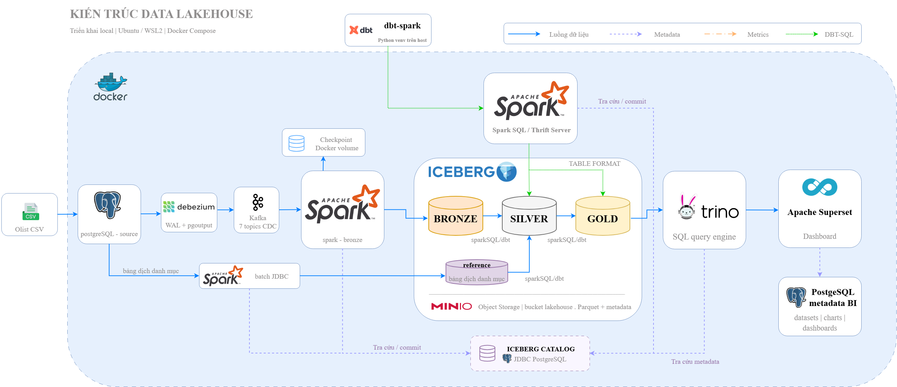
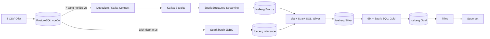
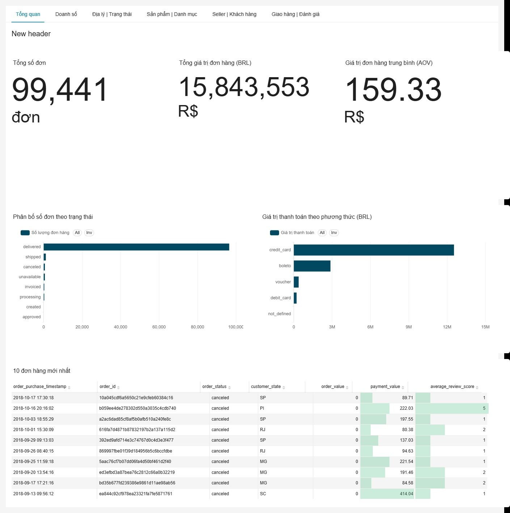
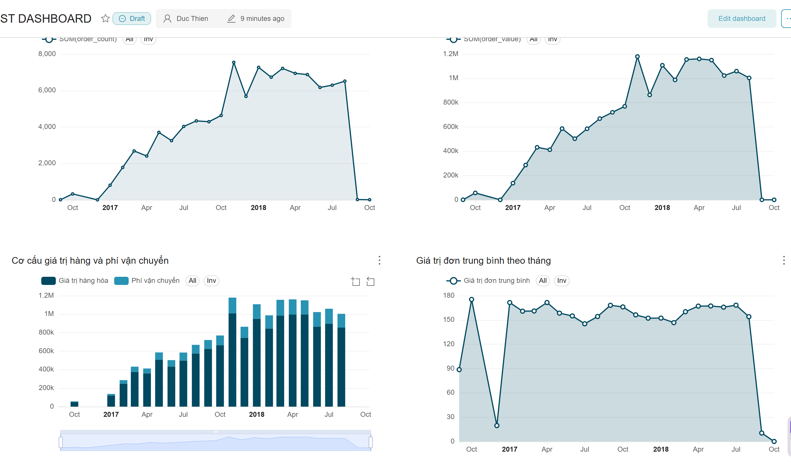
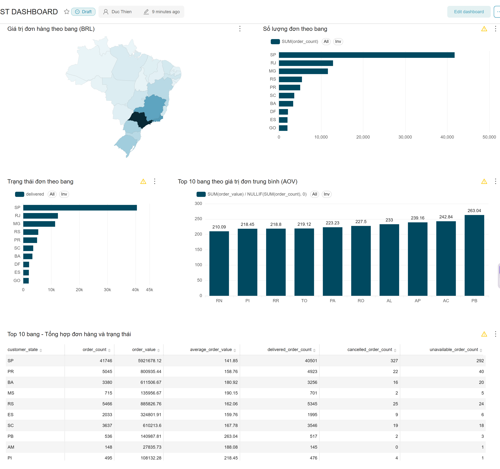
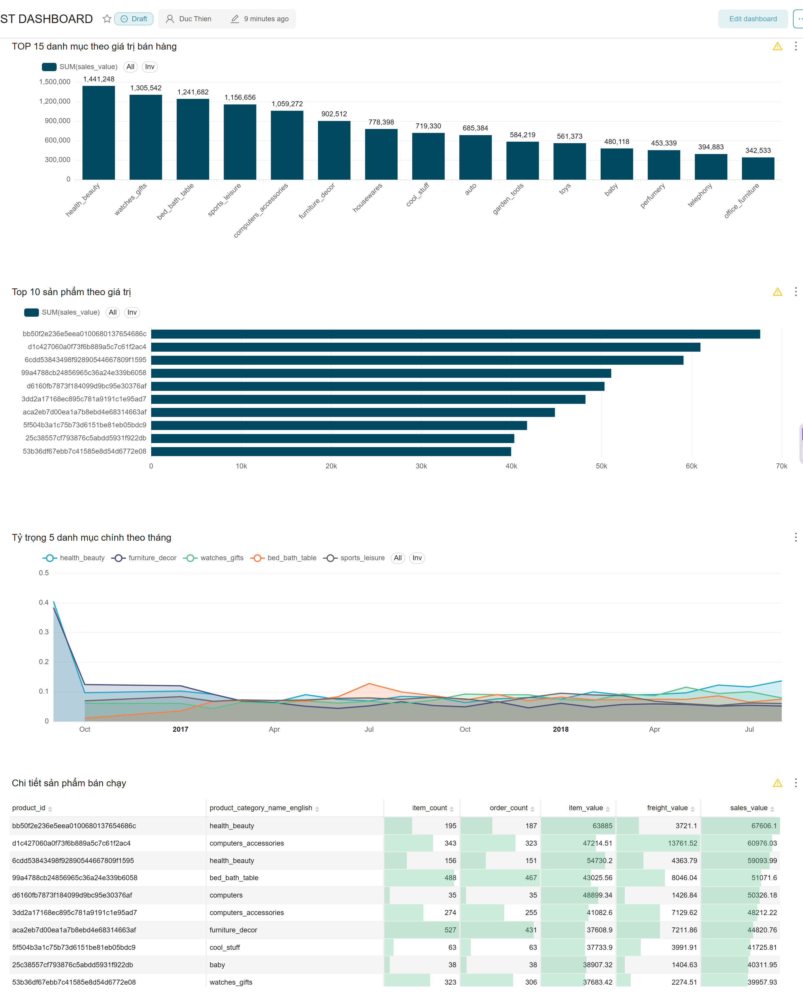
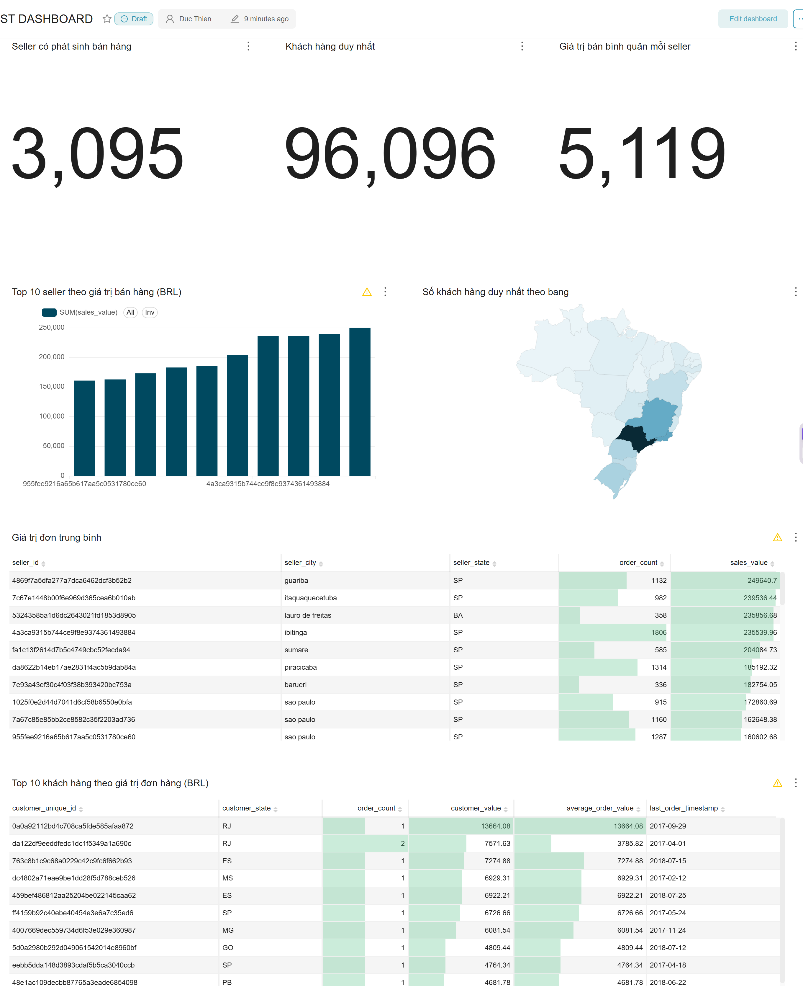
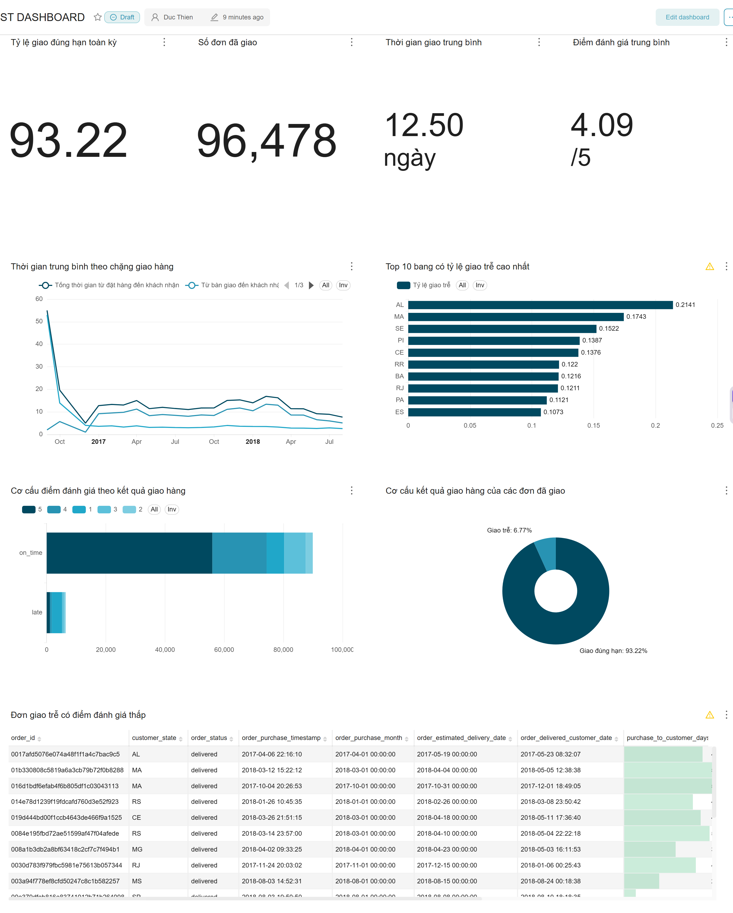

# Olist Lakehouse

Dự án CĐTN xây dựng hệ thống lakehouse để phân tích dữ liệu thương mại điện tử Olist: thu nhận thay đổi từ PostgreSQL bằng CDC, lưu lịch sử sự kiện trên Iceberg và xây dựng mô hình phân tích phục vụ dashboard Superset.

Dự án chạy local trên Ubuntu/WSL2 bằng Docker Compose. Spark phụ trách ingest và biến đổi dữ liệu; dbt quản lý SQL models, phụ thuộc và kiểm thử; Trino phục vụ truy vấn cho Superset.

**Trạng thái cập nhật: 21/11/2026.** Luồng dữ liệu đã được triển khai đến dashboard với 7 bảng Bronze, 8 bảng Silver và 21 bảng Gold. Lịch tự động chạy dbt mỗi 5 phút là bước tiếp theo, chưa được triển khai trong repository hiện tại.

## 1. Kiến trúc





Các bảng Iceberg ở Bronze, reference, Silver và Gold lưu data/metadata files trên MinIO. Spark và Trino dùng chung Iceberg JDBC catalog tên `lakehouse`, với metadata catalog lưu trong một PostgreSQL riêng.

| Thành phần | Vai trò |
| --- | --- |
| PostgreSQL nguồn | Lưu 8 bảng Olist và phát sinh thay đổi nghiệp vụ. |
| Debezium / Kafka Connect | Snapshot ban đầu, sau đó đọc thay đổi đã commit qua PostgreSQL WAL. |
| Kafka | Lưu sự kiện CDC theo topic; một topic cho mỗi bảng nghiệp vụ. |
| Spark Structured Streaming | Đọc Kafka liên tục và ghi sự kiện vào Bronze, giữ checkpoint để tiếp tục sau restart. |
| MinIO + Apache Iceberg | Lưu các bảng lakehouse, snapshot và metadata files. |
| PostgreSQL catalog | Lưu định danh bảng và đường dẫn metadata hiện hành của Iceberg. |
| dbt + Spark SQL qua Thrift | Xây dựng, kiểm thử các bảng Silver và Gold theo từng lần batch. |
| Trino | Đọc Iceberg Gold và thực thi truy vấn từ Superset. |
| Superset | Hiển thị KPI, biểu đồ, bản đồ và bảng chi tiết; metadata BI lưu trong PostgreSQL riêng. |

CDC và streaming đưa thay đổi mới vào Bronze. Silver/Gold chỉ cập nhật khi chạy dbt; dashboard đọc kết quả của lần build thành công gần nhất. Việc refresh dashboard không tự chạy dbt.

## 2. Dữ liệu và các tầng xử lý

Phạm vi sử dụng 8 CSV Olist: `customers`, `sellers`, `products`, `orders`, `order_items`, `order_payments`, `order_reviews` và `product_category_name_translation`. Dữ liệu `geolocation` nằm ngoài phạm vi hiện tại; phân tích địa lý sử dụng bang của khách hàng/seller.

| Tầng | Nội dung | Đặc điểm |
| --- | --- | --- |
| Bronze | 7 bảng sự kiện CDC | Append-only; giữ raw key/value, topic/partition/offset, thao tác `r/c/u/d`, tombstone và metadata nguồn. |
| Reference | Bảng dịch danh mục | Spark batch đọc PostgreSQL qua JDBC; chạy lại khi bảng dịch nguồn thay đổi. |
| Silver | 7 bảng nghiệp vụ + 1 bảng dịch danh mục | Chuẩn hóa kiểu dữ liệu; chọn sự kiện cuối theo khóa rồi áp dụng delete để dựng trạng thái hiện tại. |
| Gold | 7 dimensions + 4 facts + 10 marts | Mô hình phân tích cho 10 câu hỏi kinh doanh và các dashboard. |

Silver hiện dùng full build trên các snapshot Bronze được chốt trước khi chạy. Khóa logic của sự kiện Bronze là `(kafka_topic, kafka_partition, kafka_offset)`; checker kiểm tra tính duy nhất, vì Iceberg không tự áp ràng buộc PK/UNIQUE.

Gold gồm:

- **Dimensions:** `dim_date`, `dim_customer`, `dim_seller`, `dim_category`, `dim_product`, `dim_order_status`, `dim_payment_type`.
- **Facts:** `fct_orders`, `fct_order_items`, `fct_order_payments`, `fct_order_reviews`.
- **Marts:**

| Câu hỏi | Mart | Nội dung |
| --- | --- | --- |
| Q01 | `mart_orders_monthly` | Số đơn và giá trị đơn theo tháng. |
| Q02 | `mart_orders_by_state` | Phân bố đơn hàng và giá trị theo bang. |
| Q03 | `mart_order_status` | Phân bố trạng thái đơn hàng. |
| Q04 | `mart_product_sales` | Kết quả bán hàng theo sản phẩm/danh mục. |
| Q05 | `mart_category_share_monthly` | Tỷ trọng danh mục theo tháng. |
| Q06 | `mart_seller_sales` | Kết quả bán hàng theo seller. |
| Q07 | `mart_customer_value` | Giá trị đơn hàng theo khách hàng. |
| Q08 | `mart_delivery_performance` | Hiệu quả giao hàng. |
| Q09 | `mart_delivery_stages` | Thời gian ở các chặng giao hàng. |
| Q10 | `mart_delivery_review` | Mối liên hệ mô tả giữa giao hàng và đánh giá. |

Giá trị tiền tệ trên dashboard sử dụng **BRL (Real Brazil), ký hiệu R$**. `order_value` là tổng giá trị hàng hóa cộng phí vận chuyển; `payment_value` là giá trị thanh toán. Hai chỉ tiêu này cần được phân biệt khi đọc báo cáo.

## 3. Công nghệ chính

Các phiên bản dưới đây phản ánh cấu hình trong repository.

| Thành phần | Phiên bản / cấu hình |
| --- | --- |
| PostgreSQL | `17.11-bookworm` |
| Kafka / Kafka Connect | Images `quay.io/debezium/kafka:3.7` và `quay.io/debezium/connect:3.7`; Kafka KRaft một broker. |
| Apache Spark | `3.5.9`, Scala `2.12`, Java `17`; chạy local `[2]`. |
| Apache Iceberg | `1.12.0`; JDBC catalog V1; Parquet/Zstd. |
| Trino | `484` |
| dbt Core / dbt Spark | `1.11.17` / `1.11.0` |
| Apache Superset | `6.0.0`; custom image cài driver Trino và PostgreSQL. |
| MinIO | Image Chainguard; server khóa theo digest trong Compose. |
| Python client | Python `3.10`; dependencies trong [requirements.txt](requirements.txt). |

## 4. Cấu trúc repository

```text
.
├── dashboard/                       # Ảnh minh họa 6 tab Superset
├── dbt/
│   ├── dbt_project.yml              # Cấu hình models, targets và table properties
│   ├── profiles.yml                 # Kết nối Spark Thrift
│   ├── macros/                      # Quy tắc xử lý CDC và kiểm tra đầu vào Silver
│   ├── models/
│   │   ├── probe/                   # Kiểm thử kết nối dbt → Spark → Iceberg
│   │   ├── silver/                  # 8 bảng trạng thái hiện tại/tham chiếu
│   │   └── gold/                    # Dimensions, facts và marts
│   └── tests/                       # Kiểm thử nghiệp vụ Silver/Gold
├── infra/
│   ├── compose.foundation.yml       # PostgreSQL nguồn/catalog và MinIO
│   ├── compose.cdc.yml              # Kafka và Kafka Connect
│   ├── compose.lakehouse.yml        # Spark runner, Bronze job, Thrift và Trino
│   ├── compose.serving.yml          # Superset và PostgreSQL metadata BI
│   ├── debezium/                    # Template PostgreSQL connector
│   ├── spark/                       # Spark/Iceberg/S3 configuration
│   ├── trino/                       # Iceberg catalog cho Trino
│   └── superset/                    # Dockerfile và cấu hình Superset
├── scripts/                         # Profiling, nạp dữ liệu, ingest và đối soát
├── sql/                             # DDL nguồn, publication, catalog và Bronze
└── requirements.txt
```

CSV nguồn, `.env`, môi trường Python, checkpoint và báo cáo chạy local không được đưa lên Git. Tài liệu nội bộ trong `docs/` cũng đang được giữ local; README này là điểm bắt đầu cho phiên bản công khai.

## 5. Chuẩn bị môi trường local

Cần Ubuntu hoặc WSL2, Docker Engine/Docker Desktop có Docker Compose v2 và Python 3.10. Lần chạy Spark đầu tiên cần tải các JAR cấu hình trong [spark-defaults.conf](infra/spark/spark-defaults.conf).

Chạy các lệnh từ thư mục gốc của repository:

```bash
python3.10 -m venv venv-cdtn
source venv-cdtn/bin/activate
python -m pip install -r requirements.txt
```

Nếu đã có `venv-cdtn` hoạt động, chỉ cần kích hoạt lại môi trường.

Tạo `.env` local theo các biến bên dưới. Thay toàn bộ giá trị `CHANGE_ME_*` trước khi sử dụng; giữ nguyên `.env` đang dùng khi khởi động lại hệ thống có dữ liệu.

```dotenv
POSTGRES_DB=olist
POSTGRES_USER=olist
POSTGRES_PASSWORD=CHANGE_ME_POSTGRES
POSTGRES_PORT=5433

MINIO_ROOT_USER=olistadmin
MINIO_ROOT_PASSWORD=CHANGE_ME_MINIO
ICEBERG_CATALOG_PASSWORD=CHANGE_ME_CATALOG

SUPERSET_DB_PASSWORD=CHANGE_ME_SUPERSET_DB
SUPERSET_SECRET_KEY=CHANGE_ME_WITH_A_LONG_RANDOM_SECRET
SUPERSET_ADMIN_USERNAME=admin
SUPERSET_ADMIN_PASSWORD=CHANGE_ME_SUPERSET_ADMIN

BRONZE_TABLES=all
BRONZE_TRIGGER_SECONDS=60
BRONZE_MAX_OFFSETS_PER_TRIGGER=100000
```

`BRONZE_TABLES=all` chọn đủ 7 bảng; mặc định trong Compose chỉ chọn `orders,order_items`. Helper dưới đây ghép cả 4 file Compose nên cần khai báo cả các biến Superset, kể cả khi chỉ bật nhóm CDC.

Khai báo các hàm Bash trong terminal hiện tại:

```bash
olist_root="$(pwd)"

dc() {
  docker compose \
    --project-name cdtn-lakehouse \
    --env-file "$olist_root/.env" \
    -f "$olist_root/infra/compose.foundation.yml" \
    -f "$olist_root/infra/compose.cdc.yml" \
    -f "$olist_root/infra/compose.lakehouse.yml" \
    -f "$olist_root/infra/compose.serving.yml" \
    "$@"
}

dbt_local() {
  "$olist_root/venv-cdtn/bin/dbt" "$@" \
    --project-dir "$olist_root/dbt" \
    --profiles-dir "$olist_root/dbt"
}

dc --profile bronze --profile transform config --quiet
```

`dc` và `dbt_local` là hàm của phiên terminal, cần khai báo lại khi mở terminal mới. Các dịch vụ dùng chung Compose project `cdtn-lakehouse` để giữ cùng network và volumes.

### 5.1. Khi khởi tạo một môi trường hoàn toàn mới

Thực hiện theo thứ tự trước khi dùng các lệnh vận hành ở mục 6:

1. Đặt đủ 8 CSV vào `data/raw/`; tạo profile bằng `python scripts/profile_olist.py --data-dir data/raw --output data/olist_profile.json`.
2. Bật `postgres-source`; áp [001_olist_source.sql](sql/001_olist_source.sql) bằng `psql`, rồi chạy `python scripts/load_olist.py check` và `python scripts/load_olist.py load` trên database nguồn rỗng.
3. Áp [002_olist_cdc.sql](sql/002_olist_cdc.sql) bằng `psql` để tạo publication. Bật Kafka/Connect, chạy `python scripts/check_olist_cdc.py preflight`, rồi `python scripts/olist_cdc.py register` để bắt đầu snapshot.
4. Bật `postgres-catalog`, MinIO và Spark runner. [003_iceberg_catalog.sql](sql/003_iceberg_catalog.sql) được PostgreSQL catalog chạy khi khởi tạo volume mới.
5. Dùng Spark SQL áp [004_olist_bronze.sql](sql/004_olist_bronze.sql) để tạo 7 bảng Bronze và tạo namespace `lakehouse.default` trước lần kết nối Thrift đầu tiên. Hai thao tác này chạy qua Spark, không chạy bằng `psql`.
6. Dùng Spark batch chạy [ingest_olist_reference.py](scripts/ingest_olist_reference.py) với action `run` để nạp bảng dịch vào `lakehouse.reference.product_category_name_translation`.
7. Khởi chạy `spark-bronze`, đợi ingest bắt kịp mốc Kafka cần xử lý và đối soát Bronze trước khi build Silver/Gold.
8. Build/test và đối soát Silver, tiếp theo Gold, rồi mới tạo kết nối/datasets/charts trong Superset.

DDL nguồn, loader và đăng ký connector là bước bootstrap; không chạy lại toàn bộ quy trình này sau mỗi lần restart. Lần ingest đầu cần còn đủ lịch sử Kafka; không bỏ qua phần snapshot bằng cách chuyển sang đọc `latest`.

## 6. Vận hành theo từng nhóm dịch vụ

Các ví dụ sau dành cho hệ thống đã hoàn thành bootstrap. Chạy các pha luân phiên để giảm RAM: streaming Bronze, batch Silver/Gold và serving BI là các tiến trình có vòng đời riêng.

### 6.1. PostgreSQL → CDC → Bronze

```bash
dc stop spark-thrift trino superset
dc up -d postgres-source kafka connect postgres-catalog minio minio-init
python scripts/check_olist_cdc.py check

dc up -d spark-bronze
dc logs --tail=80 -f spark-bronze
```

Job tiếp tục đọc sự kiện mới theo trigger khi đang chạy. `Ctrl+C` ở lệnh xem log chỉ dừng theo dõi log. Dừng job giữ lại checkpoint; dùng lại volume checkpoint khi chạy tiếp.

### 6.2. Bronze/reference → Silver → Gold

Sau khi Bronze đã bắt kịp mốc cần xử lý, dừng các tiến trình không cần cho batch và bật Thrift. Giữ PostgreSQL nguồn hoạt động nếu đối soát Silver với nguồn.

```bash
dc stop spark-bronze connect kafka spark trino superset
dc up -d --wait --wait-timeout 600 \
  postgres-source postgres-catalog minio minio-init spark-thrift

dbt_local debug --target silver

silver_vars="$(python scripts/check_olist_silver.py capture)" && \
  test -n "$silver_vars" && \
  dbt_local build --target silver --select tag:silver --vars "$silver_vars"
```

Chỉ tiếp tục khi Silver build/tests thành công. Hai checker sau cần Spark Thrift đang chạy; đối soát với PostgreSQL cần giữ nguồn ở trạng thái phù hợp với mốc Bronze đã chọn.

```bash
python scripts/check_olist_silver.py verify
python scripts/check_olist_silver.py reference
```

Sau khi Silver đạt, build và kiểm tra Gold:

```bash
dbt_local build --target gold --select tag:gold
python scripts/check_olist_gold.py verify
```

Silver có 8 model và 73 data tests; Gold có 21 model và 155 data tests. `dbt build` thực thi cả model và tests; việc parse hoặc đếm node thành công không thay thế kết quả build/đối soát.

### 6.3. Trino → Superset

Sau khi Gold build/tests và đối soát đạt, chuyển sang nhóm phục vụ BI:

```bash
dc stop spark-thrift spark spark-bronze
dc up -d --build \
  postgres-catalog minio minio-init trino \
  postgres-superset superset-init superset

dc ps -a
dc logs --tail=80 superset-init
```

`superset-init` là tác vụ khởi tạo, hoàn tất với mã thoát `0` là bình thường. Trong Superset, tạo kết nối Trino với SQLAlchemy URI:

```text
trino://superset@trino:8080/lakehouse
```

Chọn schema `gold` khi tạo datasets. Dashboard còn sử dụng virtual datasets để phục vụ một số KPI/bảng chi tiết. Metadata connection, virtual datasets, charts và dashboard nằm trong PostgreSQL của Superset, không tự được tạo lại chỉ bằng việc clone repository.

| Địa chỉ local | Mục đích |
| --- | --- |
| <http://localhost:8088> | Superset; tài khoản theo các biến `SUPERSET_ADMIN_*`. |
| <http://localhost:8080> | Trino Web UI; xem truy vấn và trạng thái query engine. |
| <http://localhost:9001> | MinIO Console; xem bucket, Parquet và metadata Iceberg. |
| <http://localhost:9000> | MinIO S3 API. |
| <http://localhost:8083/connectors> | Kafka Connect REST API. |
| `127.0.0.1:10000` | Spark Thrift endpoint cho dbt/checkers. |
| `127.0.0.1:5433` | PostgreSQL nguồn khi dùng `POSTGRES_PORT=5433`. |

### 6.4. Dừng dịch vụ và dữ liệu lưu bền vững

```bash
dc --profile bronze --profile transform stop
```

Lệnh trên dừng container và giữ named volumes: PostgreSQL nguồn/catalog, Kafka, MinIO, checkpoint Bronze và PostgreSQL metadata Superset. Không dùng `down -v` trong quy trình dừng thông thường vì tùy chọn này xóa các named volumes của Compose project.

## 7. Công cụ kiểm tra và đối soát

| Script | Phạm vi kiểm tra |
| --- | --- |
| [profile_olist.py](scripts/profile_olist.py) | Thống kê CSV, kiểu dữ liệu, khóa và quan hệ nguồn. |
| [load_olist.py](scripts/load_olist.py) | Kiểm tra CSV với profile; nạp và đối soát 8 bảng PostgreSQL. |
| [olist_cdc.py](scripts/olist_cdc.py) | Validate template, đăng ký connector và xem trạng thái. |
| [check_olist_cdc.py](scripts/check_olist_cdc.py) | Publication/slot/connector/topics, snapshot theo khóa và từng cột. |
| [check_olist_bronze.py](scripts/check_olist_bronze.py) | Đối chiếu Kafka và Bronze tại khoảng offset/snapshot; phát hiện thiếu, thừa, trùng và sai nội dung. |
| [check_olist_silver.py](scripts/check_olist_silver.py) | Replay Bronze độc lập, đối chiếu PK/từng cột/lineage với Silver và PostgreSQL; kiểm tra reference và baseline chạy lại. |
| [check_olist_gold.py](scripts/check_olist_gold.py) | Kiểm tra khóa fact, công thức giá trị, tổng hợp mart và tỷ trọng. |

Các action `validate` chỉ kiểm tra cấu hình, không chứng minh dữ liệu đã đúng. Bronze verify chạy qua `spark-submit` trong Spark runner; Silver/Gold verify chạy từ Python client và kết nối Spark Thrift. Khi đối soát, cần giữ cố định mốc dữ liệu và tránh build đồng thời với checker.

## 8. Dashboard minh họa

Dashboard gồm 6 tab. Mở từng mục để xem ảnh đã lưu trong [dashboard/](dashboard/). Các ảnh là kết quả tại thời điểm chụp, không tự cập nhật theo dữ liệu mới.

<details open>
<summary><strong>1. Tổng quan</strong> — KPI đơn hàng, trạng thái, thanh toán và các đơn mới nhất.</summary>



</details>

<details>
<summary><strong>2. Doanh số</strong> — số đơn, giá trị đơn, AOV và cơ cấu giá trị hàng/phí vận chuyển theo tháng.</summary>



</details>

<details>
<summary><strong>3. Địa lý | Trạng thái</strong> — bản đồ, top bang và phân bố trạng thái theo bang.</summary>



</details>

<details>
<summary><strong>4. Sản phẩm | Danh mục</strong> — sản phẩm/danh mục dẫn đầu và thay đổi tỷ trọng theo thời gian.</summary>



</details>

<details>
<summary><strong>5. Seller | Khách hàng</strong> — phân bố địa lý, KPI và bảng xếp hạng giá trị seller/khách hàng.</summary>



</details>

<details>
<summary><strong>6. Giao hàng | Đánh giá</strong> — giao đúng hạn/trễ, thời gian giao hàng và điểm đánh giá.</summary>



</details>

## 9. Hiện trạng và bước phát triển tiếp theo

| Hạng mục | Hiện trạng |
| --- | --- |
| PostgreSQL nguồn, CDC và Kafka | Đã triển khai; đã thực nghiệm snapshot, thay đổi `c/u/d`, tombstone và phục hồi CDC sau restart. |
| Bronze | Đã ingest và đối soát đủ 7 bảng sự kiện. |
| Silver | Đã xây dựng, kiểm thử và đối soát 7 bảng nghiệp vụ cùng bảng dịch danh mục. |
| Gold | Đã xây dựng star schema và 10 marts làm nguồn phân tích. |
| Superset | Đã có dashboard 6 tab; ảnh minh họa được lưu trong repository. |
| Lịch chạy dbt mỗi 5 phút | Dự kiến triển khai; hiện chạy bằng lệnh theo từng pha. |
| Export/import cấu hình BI | Còn cần bổ sung để tái tạo connections, virtual datasets, charts và dashboard. |
| Đo lường độ trễ và khả năng phục hồi | Cần bổ sung báo cáo thực nghiệm, log/offset và kết quả đối soát tại các mốc cụ thể. |

Các giới hạn cần giữ khi diễn giải kết quả:

- Kafka hiện là một broker; Spark chạy local, chưa là cụm phân tán có HA.
- Bronze ingest liên tục khi job đang chạy; Silver/Gold hiện là full batch. Chưa cam kết độ trễ đầu cuối hoặc exactly-once cho toàn hệ thống.
- Snapshot Bronze được chốt theo từng bảng; chưa bảo đảm một snapshot giao dịch chung cho mọi bảng khi nguồn thay đổi liên tục.
- Dữ liệu Olist là dữ liệu lịch sử; thay đổi phát sinh dùng để thực nghiệm CDC cần kịch bản mô phỏng có kiểm soát.
- Các chart/virtual datasets có thể áp thêm công thức và bộ lọc. Khi đối chiếu KPI cần dùng cùng phạm vi, grain và mốc dữ liệu với facts/marts.
