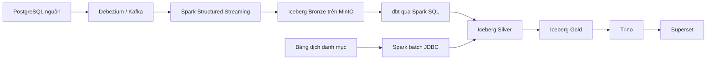
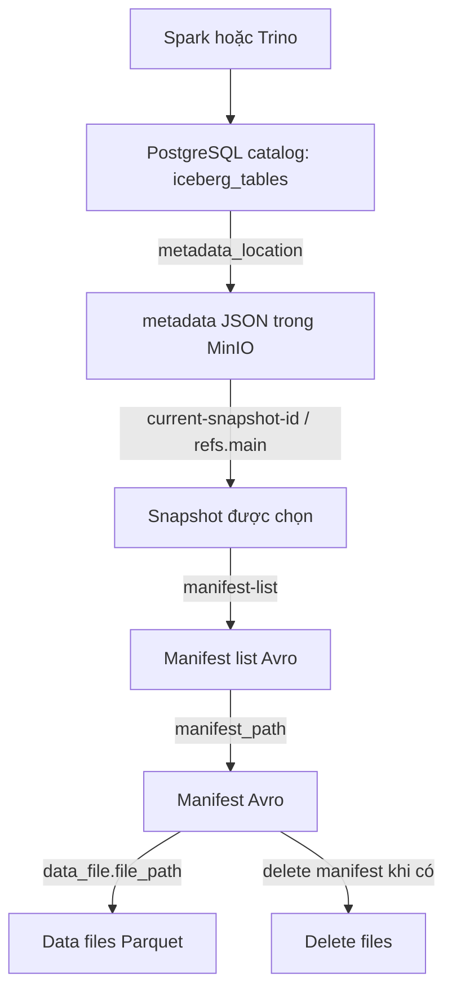

# Iceberg: metadata, manifest list và manifest trong CĐTN Lakehouse

Tài liệu tra cứu cơ chế lưu trữ và cách kiểm tra Iceberg của dự án. Nội dung được biên soạn từ ghi chú `iceberg.txt`, ba file mẫu `orders_probe` đã cung cấp trong phiên trao đổi và tài liệu chính thức; đã loại phần lặp và hiệu chỉnh các nhận định dễ gây nhầm.

**Mốc biên soạn: 15/11/2026.** Giá trị mẫu trong tài liệu là bằng chứng của các file đã nhận, không phải kết luận về trạng thái dịch vụ hiện tại. Các lệnh thực hành bên dưới chỉ đọc dữ liệu/metadata; chưa được chạy lại trên cụm trong lần biên soạn này.

## Mục lục

- [1. Phạm vi và kiến trúc đang áp dụng](#1-phạm-vi-và-kiến-trúc-đang-áp-dụng)
- [2. Bản đồ lưu trữ và đường đi đọc/ghi](#2-bản-đồ-lưu-trữ-và-đường-đi-đọcghi)
- [3. Phân biệt các loại ID và trạng thái](#3-phân-biệt-các-loại-id-và-trạng-thái)
- [4. Tra cứu key của metadata JSON](#4-tra-cứu-key-của-metadata-json)
- [5. Tra cứu key của manifest list](#5-tra-cứu-key-của-manifest-list)
- [6. Tra cứu key của manifest](#6-tra-cứu-key-của-manifest)
- [7. Nối ba file mẫu thành một chuỗi kiểm chứng](#7-nối-ba-file-mẫu-thành-một-chuỗi-kiểm-chứng)
- [8. Thực hành Bash: xem trực tiếp, không tải file](#8-thực-hành-bash-xem-trực-tiếp-không-tải-file)
- [9. Đối soát và cách diễn giải kết quả](#9-đối-soát-và-cách-diễn-giải-kết-quả)
- [10. Đề xuất kỹ thuật cho các chặng tiếp theo](#10-đề-xuất-kỹ-thuật-cho-các-chặng-tiếp-theo)
- [11. Những điểm đã hiệu chỉnh từ ghi chú ban đầu](#11-những-điểm-đã-hiệu-chỉnh-từ-ghi-chú-ban-đầu)
- [12. Nguồn tham khảo](#12-nguồn-tham-khảo)

Tra cứu hằng ngày: khai báo helper ở **8.2**, lấy con trỏ/snapshot ở **8.3 và 8.6**, xem file ở **8.10**, xem metrics ở **8.11**, đọc dữ liệu thật ở **8.12**. Dùng **8.4** khi cần key JSON thô và **8.13** khi cần ghim cùng mốc kiểm chứng.

## 1. Phạm vi và kiến trúc đang áp dụng

Luồng đã chốt trong [architecture.md](architecture.md), [decisions.md](decisions.md) và [AGENTS.md](../AGENTS.md):



Đây là vai trò kiến trúc. Tại mốc đọc cấu hình, Spark là runner `local[2]` chạy nền bằng `sleep infinity`; điều đó chưa khởi động job streaming hay dbt endpoint. Việc tạo bảng thử thành công xác nhận một phần kết nối Spark–catalog–MinIO–Trino, chưa xác nhận toàn bộ pipeline Bronze/Silver/Gold.

| Thành phần/khái niệm | Vai trò trong dự án |
| --- | --- |
| PostgreSQL nguồn | Lưu 8 bảng Olist; 7 bảng nghiệp vụ đi qua CDC. |
| Kafka | Lưu chuỗi sự kiện CDC theo topic/partition/offset. |
| Spark | Đọc Kafka, ghi Iceberg và thực thi biến đổi SQL cho dbt theo thiết kế. |
| dbt | Quản lý model, phụ thuộc và kiểm thử dữ liệu; engine thực thi là Spark. |
| PostgreSQL catalog | Lưu đăng ký bảng, namespace properties và con trỏ đến metadata JSON. |
| MinIO | Lưu các object metadata, manifest và data/delete file. |
| Trino | Đọc bảng dùng chung catalog để truy vấn, kiểm tra và phục vụ Superset. Quyền chỉ đọc còn cần được thực thi bằng cấu hình phân quyền. |
| Iceberg | Table format và thư viện quản lý schema, snapshot, file và commit; không phải một database server riêng. |
| Namespace | Nhóm bảng trong catalog, gần với khái niệm schema SQL; không đồng nghĩa schema cột của một bảng. |

### 1.1. Phiên bản và địa chỉ phải phân biệt

| Mục | Giá trị trong cấu hình đã đọc | Ý nghĩa |
| --- | --- | --- |
| Spark | `3.5.9`, Scala `2.12`, Java `17` | Runtime thực thi. |
| Iceberg library | `1.12.0` | Phiên bản thư viện Spark nạp qua JAR. |
| Iceberg table format của mẫu | `2` | Quy tắc lưu metadata của bảng; có hỗ trợ row-level delete files. |
| JDBC catalog schema | `V1` | Phiên bản cấu trúc bảng quản lý catalog trong PostgreSQL. Không phải table format V1. |
| Trino | `484` | Engine truy vấn; cú pháp metadata khác Spark. |
| Catalog | `lakehouse` | Tên dùng chung trong Spark, Trino và hàng đăng ký JDBC catalog. |
| Warehouse | `s3://olist-lakehouse/warehouse` | Prefix gốc cho bảng trong MinIO. |
| S3 endpoint nội bộ | `http://minio:9000` | Endpoint engine truy cập trong mạng Compose. |
| MinIO Console từ host | `http://localhost:9001` | Duyệt object trên giao diện; không thay thế SQL đối soát. |
| Trino từ host | `http://localhost:8080` | Web UI theo dõi query; DBeaver kết nối đến Trino để đọc bảng. |

Phạm vi tra cứu dưới đây tập trung **table format V2** của mẫu. Không áp dụng mặc định các trường hoặc cơ chế chỉ có ở format mới hơn.

### 1.2. Truy vết file cấu hình đến chức năng

| File | Được sử dụng ở đâu | Chức năng liên quan Iceberg |
| --- | --- | --- |
| [`infra/compose.foundation.yml`](../infra/compose.foundation.yml) | Docker Compose | Chạy MinIO, tạo bucket bằng `minio-init`, chạy PostgreSQL catalog và gắn SQL khởi tạo. |
| [`sql/003_iceberg_catalog.sql`](../sql/003_iceberg_catalog.sql) | `/docker-entrypoint-initdb.d/001_iceberg_catalog.sql` trong `postgres-catalog` | Tạo hai bảng catalog khi volume PostgreSQL được khởi tạo lần đầu. Restart container không tự chạy lại SQL này trên volume đã có dữ liệu. |
| [`infra/compose.lakehouse.yml`](../infra/compose.lakehouse.yml) | Docker Compose | Chạy Spark/Trino, truyền biến môi trường và mount cấu hình vào từng container. |
| [`infra/spark/spark-defaults.conf`](../infra/spark/spark-defaults.conf) | Mount vào `/opt/spark/conf-template/spark-defaults.conf`; entrypoint sao chép sang `/tmp/spark-conf/spark-defaults.conf` | Nạp Iceberg/Kafka/JDBC JAR, khai báo `lakehouse`, JDBC catalog và `S3FileIO`. Mật khẩu JDBC được thêm trong container. |
| [`infra/trino/catalog/iceberg.properties`](../infra/trino/catalog/iceberg.properties) | Mount thành `/etc/trino/catalog/lakehouse.properties` | Khai báo connector Iceberg, cùng JDBC catalog và S3 endpoint. Tên file đích tạo tên catalog Trino `lakehouse`. |
| `.env` | Compose nội suy và truyền vào container | Cung cấp thông tin xác thực local. Không đưa nội dung hoặc mật khẩu vào tài liệu/log. |

Spark hiện dùng Iceberg `S3FileIO`. Vì vậy đường dẫn thực tế là `s3://...`; không tự đổi sang `s3a://...` hay giả định `spark.read.json("s3://...")` dùng được như một Hadoop S3A filesystem đã cấu hình.

## 2. Bản đồ lưu trữ và đường đi đọc/ghi

### 2.1. Chuỗi tham chiếu



| Cấp | Đơn vị được mô tả | Trả lời câu hỏi |
| --- | --- | --- |
| Catalog | Một bảng đã đăng ký | Bảng tên gì, thuộc namespace nào, metadata JSON hiện tại ở đâu? |
| Metadata JSON | Trạng thái quản lý của bảng | Schema/spec/sort nào đang dùng, snapshot nào được chọn, những snapshot nào còn được giữ? |
| Manifest list | Tập manifest của một snapshot | Snapshot gồm những manifest nào, mỗi manifest dùng spec nào và có thống kê partition ra sao? |
| Manifest | Một nhóm data files hoặc một nhóm delete files | File ở đâu, có bao nhiêu record, kích thước và metrics cột thế nào? |
| Data file | Dữ liệu cột thực tế | Giá trị `id`, `amount` hoặc các cột nghiệp vụ là gì? |
| Delete file | Chỉ dẫn loại bỏ dòng khi đọc | Dòng nào trong data files không còn được trả về? Chỉ xuất hiện khi cách ghi cần loại file này. |

Một manifest thuộc **một loại nội dung**: data hoặc deletes. Bảng có thể dùng cả hai loại manifest. Delete files không phải bản sao Kafka message `op=d`.

### 2.2. Object của bảng mẫu

```text
s3://olist-lakehouse/warehouse/architecture_poc_20261113/orders_probe/
├── metadata/
│   ├── 00000-abae70a6-a324-49a3-9568-7b4efc445cf6.metadata.json
│   ├── snap-364360660195123112-1-6b4c3395-3d89-4e94-999d-ad17dde355da.avro
│   └── 6b4c3395-3d89-4e94-999d-ad17dde355da-m0.avro
└── data/
    ├── 00000-0-a4cddcd8-6863-4a33-bb89-2923b3f0ef5a-0-00001.parquet
    └── 00001-1-a4cddcd8-6863-4a33-bb89-2923b3f0ef5a-0-00001.parquet
```

Đây là prefix/object key trên MinIO; giao diện trình bày giống thư mục. Bảng hiện tại có thể có thêm file nếu đã được ghi tiếp. Tên file giúp nhận dạng nhưng **không phải quy tắc chọn phiên bản hiện hành**: bắt đầu từ con trỏ catalog, sau đó theo snapshot/ref.

### 2.3. Khi Spark ghi

1. Spark nạp cấu hình `lakehouse`, đọc đăng ký bảng từ JDBC catalog và metadata cần thiết.
2. Các task ghi data/delete files cần thiết vào MinIO. Iceberg coi file đã commit là bất biến; thay đổi được biểu diễn bằng các file/tham chiếu mới.
3. Iceberg tạo hoặc tái sử dụng manifest; tạo manifest list khi tạo snapshot mới; ghi metadata JSON mới.
4. Thư viện catalog cập nhật con trỏ trong PostgreSQL bằng cơ chế commit có kiểm tra phiên bản cũ. Nếu có xung đột, commit phải kiểm tra lại/retry hoặc thất bại.
5. Reader nạp trạng thái đã commit và thấy một snapshot nhất quán của **một bảng**, thay vì thấy một phần kết quả task.

Metadata-only commit, như đổi table property, có thể tạo metadata JSON mới mà không tạo snapshot dữ liệu mới. Một snapshot có thể tái sử dụng manifest/data files cũ. Không có quy tắc “mỗi batch luôn tạo đúng một file của từng loại”. File ghi xong nhưng commit thất bại có thể trở thành orphan.

MinIO hỗ trợ ghi đè/xóa object; tính bất biến ở đây là cách Iceberg quản lý file đã commit. Dự án chưa cấu hình Object Lock. Tính nguyên tử của commit dựa vào catalog và giao thức Iceberg, không phải việc liệt kê thư mục trên MinIO. Xem [Iceberg Reliability](https://iceberg.apache.org/docs/latest/reliability/) và [JDBC catalog](https://iceberg.apache.org/docs/latest/jdbc/).

### 2.4. Khi Trino đọc

1. Nhận `lakehouse.namespace.table` từ SQL.
2. Lấy `metadata_location` từ catalog và nạp metadata JSON, có thể dùng cache phù hợp.
3. Chọn snapshot mặc định hoặc snapshot được chỉ định bằng time travel.
4. Đọc manifest list; dùng partition summaries để bỏ qua manifest chắc chắn không phù hợp.
5. Đọc manifest cần thiết; dùng partition/column metrics để loại file chắc chắn không phù hợp.
6. Đọc phần dữ liệu cần thiết trong Parquet, áp dụng delete files nếu có và trả kết quả.

Ví dụ mẫu có `upper_bound(amount)=50.00` ở file thứ hai: điều kiện `amount > 70` cho phép loại file này dựa trên metrics. File có khoảng giá trị phù hợp vẫn cần được đọc/lọc; metrics không liệt kê mọi giá trị. Mẫu chưa partition nên chưa minh họa việc bỏ manifest theo partition. Xem [Iceberg Performance](https://iceberg.apache.org/docs/latest/performance/).

## 3. Phân biệt các loại ID và trạng thái

### 3.1. Các loại ID không thể thay thế nhau

| Key/khái niệm | Ý nghĩa | Liên hệ mẫu |
| --- | --- | --- |
| `table-uuid` | Danh tính bảng, hữu ích để phát hiện việc thay bằng bảng khác cùng tên. | `19d29ad3-7f32-4665-a974-b7c143aa565e` |
| `schema-id` | Danh tính một phiên bản schema cột. | `0` |
| Field ID | Danh tính ổn định của cột trong schema; metrics dùng ID này thay cho vị trí cột. | `1` là `id`; `2` là `amount`. |
| `spec-id` | Danh tính một partition specification. | `0`, không có partition fields. |
| Partition field ID | Danh tính của một trường partition đã biến đổi. | Chưa có; ID dành cho partition bắt đầu từ `1000`. |
| `order-id` | Danh tính một sort order. | `0` biểu diễn unsorted. |
| `snapshot-id` | Định danh snapshot, không phải số thứ tự tăng dần. | `364360660195123112` |
| `sequence-number` | Thứ tự logic do Iceberg gán cho snapshot V2; giúp đánh giá quan hệ data/delete files. | `1`; không phải Kafka offset hay PostgreSQL LSN. |

Snapshot ID là số nguyên 64-bit. Khi xử lý JSON bằng công cụ trung gian, cần giữ nguyên chữ số; tránh chuyển sang JavaScript `Number` hoặc công cụ có thể làm tròn số lớn. SQL `BIGINT` và Python `int` phù hợp để giữ chính xác giá trị mẫu.

### 3.2. Ba trường dễ nhầm vì đều dùng số

| Key | Mã đúng | Ý nghĩa vận hành |
| --- | --- | --- |
| Manifest-list record `content` | `0=data`; `1=deletes` | Phân loại manifest được tham chiếu. |
| Manifest entry `status` | `0=EXISTING`; `1=ADDED`; `2=DELETED` | Trạng thái tham chiếu một file trong manifest. |
| Manifest entry `data_file.content` | `0=data`; `1=position deletes`; `2=equality deletes` | Phân loại file được tham chiếu. |

`status=2` không phải Kafka tombstone. `data_file.content=2` không phải `status=2`. Cũng không thể kết luận “chưa từng UPDATE/DELETE” chỉ vì mọi manifest hiện có `content=0`: copy-on-write có thể thay data files mà không cần delete files. Mã trạng thái theo [Iceberg Specification](https://iceberg.apache.org/spec/#manifests).

## 4. Tra cứu key của metadata JSON

Quy ước: `[]` nghĩa là từng phần tử mảng; đường dẫn trong cột đầu xác định **một key**. Dấu `-` trong tên JSON được giữ nguyên. Giá trị “không có trong mẫu” là trường để tham khảo khi bảng phát triển, không phải lỗi thiếu cấu hình.

### 4.1. Danh tính, phiên bản và các con trỏ cấp bảng

| Key | Ý nghĩa | Giá trị trong mẫu / cách đọc |
| --- | --- | --- |
| `format-version` | Phiên bản table format quyết định cấu trúc và khả năng của bảng. | `2` |
| `table-uuid` | UUID nhận dạng bảng. | `19d29ad3-7f32-4665-a974-b7c143aa565e` |
| `location` | Vị trí gốc của bảng; không phải JDBC URL. | `s3://olist-lakehouse/warehouse/architecture_poc_20261113/orders_probe` |
| `last-sequence-number` | Sequence number cao nhất đã được cấp cho snapshot của bảng. | `1`; rollback không làm sequence này trở thành Kafka offset. |
| `last-updated-ms` | Thời điểm metadata bảng được cập nhật, epoch milliseconds. | `1794620555365` = `14/11/2026 08:42:35.365 +07:00`. |
| `last-column-id` | Field ID cao nhất đã được cấp, giúp không tái dùng ID cột đã xóa. | `2`; không phải số lượng cột trong mọi trường hợp. |
| `current-schema-id` | Chọn schema cột hiện hành trong `schemas`. | `0` |
| `schemas` | Danh sách phiên bản schema còn lưu trong metadata. | Một schema. |
| `default-spec-id` | Partition spec mặc định cho việc ghi mới. | `0` |
| `partition-specs` | Danh sách partition specs để đọc được cả file cũ và mới khi spec thay đổi. | Một spec rỗng. |
| `last-partition-id` | ID partition field cao nhất đã cấp. | `999` là mốc khởi đầu trước field đầu tiên `1000`, không phải có 999 partition. |
| `default-sort-order-id` | Sort order mặc định cho việc ghi mới. | `0` |
| `sort-orders` | Các sort orders đã đăng ký. | Một order rỗng. |
| `properties` | Map cấu hình/thuộc tính của bảng. | Có owner và codec Parquet. |
| `current-snapshot-id` | Snapshot đang được chọn làm trạng thái mặc định. | `364360660195123112`; bảng chưa có dữ liệu có thể chưa có snapshot. |
| `refs` | Map tên branch/tag đến snapshot và chính sách giữ lịch sử. | Có `main`. |
| `snapshots` | Các snapshot còn được metadata giữ lại; không phải toàn bộ lịch sử vĩnh viễn. | Một snapshot. |
| `snapshot-log` | Lịch sử chuyển snapshot thành current. | Một lần chuyển. |
| `metadata-log` | Tham chiếu các metadata JSON trước đó còn được giữ trong log. | `[]` ở metadata đầu tiên. |
| `statistics` | Đăng ký các file thống kê bổ sung; không chứa dữ liệu bảng. | `[]`; không có nghĩa không có column metrics trong manifest. |
| `partition-statistics` | Đăng ký file thống kê theo partition khi được tạo. | `[]` |

### 4.2. Schema cột

| Key | Ý nghĩa | Giá trị trong mẫu |
| --- | --- | --- |
| `schemas[].type` | Loại cấu trúc schema cấp bảng. | `struct` |
| `schemas[].schema-id` | ID của phiên bản schema này. | `0` |
| `schemas[].fields` | Các cột cấp đầu của schema. | Hai cột. |
| `schemas[].fields[].id` | Field ID dùng để nhận diện cột và nối sang metrics. | `1` cho `id`; `2` cho `amount`. |
| `schemas[].fields[].name` | Tên cột hiển thị trong SQL. | `id` hoặc `amount`. |
| `schemas[].fields[].required` | Cột có bắt buộc khác NULL hay không ở schema Iceberg. | `false` ở cả hai cột. |
| `schemas[].fields[].type` | Kiểu Iceberg, gồm độ chính xác/scale khi là decimal. | `long`; `decimal(12, 2)`. |

Field ID không phải primary key nghiệp vụ. `id` tên cột có field ID `1` không tự tạo ràng buộc duy nhất. Namespace `architecture_poc_20261113` chứa bảng, còn schema phía trên mô tả cột **bên trong** bảng.

### 4.3. Partition spec

| Key | Ý nghĩa | Giá trị mẫu / khi có partition |
| --- | --- | --- |
| `partition-specs[].spec-id` | ID của partition spec. | `0` |
| `partition-specs[].fields` | Các phép biến đổi dùng chia partition. | `[]`: bảng không partition. |
| `partition-specs[].fields[].source-id` | Field ID cột đầu vào. | Không có trong mẫu. |
| `partition-specs[].fields[].field-id` | ID riêng của trường partition, khác source field ID. | Không có trong mẫu. |
| `partition-specs[].fields[].name` | Tên trường partition sau biến đổi. | Ví dụ `event_day`, nếu thiết kế như vậy. |
| `partition-specs[].fields[].transform` | Phép biến đổi như `day`, `bucket[N]`, `identity`. | Không có trong mẫu; không mặc định mọi timestamp đều phải partition theo ngày. |

### 4.4. Sort order

| Key | Ý nghĩa | Giá trị mẫu / khi có sort |
| --- | --- | --- |
| `sort-orders[].order-id` | ID của sort order. | `0`: unsorted. |
| `sort-orders[].fields` | Các trường và thứ tự sắp xếp khi ghi. | `[]` |
| `sort-orders[].fields[].source-id` | Field ID nguồn để sắp xếp. | Không có trong mẫu. |
| `sort-orders[].fields[].transform` | Phép biến đổi áp dụng trước khi sắp xếp. | Không có trong mẫu. |
| `sort-orders[].fields[].direction` | Chiều sắp xếp. | `asc` hoặc `desc` khi được cấu hình. |
| `sort-orders[].fields[].null-order` | Vị trí NULL trong sort. | `nulls-first` hoặc `nulls-last`. |

Sort order không bảo đảm `SELECT` trả đúng thứ tự mong muốn nếu câu SQL không có `ORDER BY`.

### 4.5. Table properties có trong mẫu

| Key | Ý nghĩa | Giá trị mẫu |
| --- | --- | --- |
| `properties.owner` | Thuộc tính owner do engine ghi; không thay thế chính sách phân quyền. | `spark` |
| `properties.write.parquet.compression-codec` | Codec nén cho các file Parquet được ghi theo cấu hình này. | `zstd`; khác codec `deflate` của Avro mẫu. |

Không thấy một property trong JSON không đồng nghĩa tính năng bị tắt: thư viện có thể dùng mặc định. Phải phân biệt property được lưu với giá trị hiệu lực của engine.

### 4.6. Snapshot reference và lịch sử

| Key | Ý nghĩa | Giá trị mẫu / lưu ý |
| --- | --- | --- |
| `refs.main` | Reference tên `main`; nhánh mặc định của bảng. | Một object reference. |
| `refs.main.snapshot-id` | Snapshot mà `main` đang trỏ đến. | `364360660195123112` |
| `refs.main.type` | Loại reference. | `branch`; reference khác có thể là `tag`. |
| `refs.main.min-snapshots-to-keep` | Số snapshot tối thiểu giữ cho branch nếu được đặt. | Không có trong mẫu. |
| `refs.main.max-snapshot-age-ms` | Chính sách tuổi snapshot của branch nếu được đặt. | Không có trong mẫu. |
| `refs.<name>.max-ref-age-ms` | Giới hạn tuổi reference khi áp dụng; `main` có quy tắc giữ riêng. | Không có trong mẫu. |
| `snapshot-log[].timestamp-ms` | Thời điểm snapshot được chọn thành current. | `1794620555362` |
| `snapshot-log[].snapshot-id` | Snapshot được chọn ở lần chuyển đó. | `364360660195123112` |
| `metadata-log[].timestamp-ms` | Thời điểm gắn với phiên bản metadata JSON cũ. | Không có phần tử trong mẫu. |
| `metadata-log[].metadata-file` | URI của metadata JSON cũ. | Không có phần tử trong mẫu. |

Sau rollback, snapshot current có thể không phải snapshot có timestamp lớn nhất; snapshot ID cũng không tăng tuần tự. Kiểm tra `main`/con trỏ current, không chọn bằng `MAX(snapshot_id)` hay tên file lớn nhất.

### 4.7. Một phần tử `snapshots[]`

| Key | Ý nghĩa | Giá trị mẫu |
| --- | --- | --- |
| `snapshots[].sequence-number` | Sequence của snapshot V2. | `1` |
| `snapshots[].snapshot-id` | ID snapshot. | `364360660195123112` |
| `snapshots[].parent-snapshot-id` | Snapshot cha nếu có. | Không có trong JSON mẫu; header manifest list giải mã ra `null`. |
| `snapshots[].timestamp-ms` | Thời điểm tạo snapshot, epoch milliseconds. | `1794620555362` = `14/11/2026 08:42:35.362 +07:00`. |
| `snapshots[].manifest-list` | URI manifest list của snapshot. | File `snap-364360660195123112-1-6b4c3395-3d89-4e94-999d-ad17dde355da.avro`. |
| `snapshots[].schema-id` | Schema gắn với snapshot. | `0` |
| `snapshots[].summary` | Map thông tin tóm tắt commit và snapshot. Giá trị trong mẫu thường là chuỗi. | Xem từng key bên dưới. |

Chênh 3 ms giữa timestamp snapshot và timestamp metadata của mẫu là bình thường: đây là hai mốc ghi khác nhau.

### 4.8. `snapshots[].summary`: thay đổi file và tổng trạng thái

Các key sau nằm **bên trong summary của một snapshot**. Không coi các bộ đếm file là số thao tác nghiệp vụ `c/u/d`.

| Key | Ý nghĩa | Giá trị mẫu / giới hạn diễn giải |
| --- | --- | --- |
| `operation` | Loại thao tác Iceberg của commit. | `overwrite`, phù hợp thao tác tạo/thay bảng bằng truy vấn ở POC; không phải Kafka `op=u`. |
| `manifests-created` | Số manifest được tạo bởi thao tác. | `"1"` |
| `manifests-kept` | Số manifest được giữ lại theo cách writer tính summary. | `"0"` |
| `manifests-replaced` | Số manifest được thay thế theo thao tác. | `"0"` |
| `added-data-files` | Số data files được thêm trong commit. | `"2"` |
| `added-records` | Số record trong các data files thêm vào, không tự đồng nghĩa số bản ghi nghiệp vụ mới. | `"2"`; rewrite/update có thể ghi lại record cũ. |
| `added-files-size` | Tổng byte của các file được thêm theo summary. | `"1406"`; không gồm toàn bộ metadata của bảng. |
| `changed-partition-count` | Số nhóm partition bị ảnh hưởng mà writer ghi nhận. | `"1"`; bảng không partition vẫn có một nhóm logic. |
| `total-records` | Tổng record trong data files của snapshot theo summary, trước khi suy diễn ảnh hưởng row-level deletes. | `"2"`; không luôn bằng `COUNT(*)` khi có delete files. |
| `total-files-size` | Dung lượng file thuộc snapshot được summary thống kê. | `"1406"`; không phải dung lượng toàn prefix gồm mọi lịch sử. |
| `total-data-files` | Tổng data files của snapshot. | `"2"` |
| `total-delete-files` | Tổng delete files của snapshot. | `"0"` |
| `total-position-deletes` | Tổng delete records loại position theo summary. | `"0"`; không đồng nghĩa luôn bằng số dòng nghiệp vụ bị xóa. |
| `total-equality-deletes` | Tổng delete records loại equality theo summary. | `"0"`; một điều kiện xóa có thể ảnh hưởng nhiều dòng. |

### 4.9. `snapshots[].summary`: nguồn gốc job

| Key | Ý nghĩa | Giá trị mẫu |
| --- | --- | --- |
| `spark.app.id` | ID Spark application do writer đưa vào summary. | `local-1794620545702` |
| `app-id` | ID ứng dụng trong thông tin môi trường ghi. | `local-1794620545702` |
| `app-name` | Tên ứng dụng ghi. | `SparkSQL::172.18.0.4` |
| `engine-name` | Engine thực hiện commit. | `spark` |
| `engine-version` | Phiên bản engine. | `3.5.9` |
| `iceberg-version` | Phiên bản thư viện Iceberg thực hiện commit. | `Apache Iceberg 1.12.0 (commit 212aa894e919ff9fdf89160da4aadcbe6858ac01)` |

Nguồn gốc job hữu ích để nối snapshot sang log Spark/dbt. Những key summary bổ sung phụ thuộc writer/thao tác; không bắt buộc mọi engine đều ghi đủ các key trên. Đối chiếu cấu trúc với [TableMetadata.java, tag 1.12.0](https://github.com/apache/iceberg/blob/apache-iceberg-1.12.0/core/src/main/java/org/apache/iceberg/TableMetadata.java) và [SnapshotSummary.java, tag 1.12.0](https://github.com/apache/iceberg/blob/apache-iceberg-1.12.0/core/src/main/java/org/apache/iceberg/SnapshotSummary.java).

## 5. Tra cứu key của manifest list

File mẫu: `snap-364360660195123112-1-6b4c3395-3d89-4e94-999d-ad17dde355da.avro`, kích thước **4470 bytes**, codec **deflate**, chứa **một record** trỏ tới một manifest.

Avro là định dạng nhị phân tự mô tả schema. Khi giải mã, cần phân biệt **header metadata của Avro** với **record nghiệp vụ metadata Iceberg**. Không áp dụng quy tắc engine luôn phải đọc tuần tự mọi manifest; việc chọn file còn phụ thuộc pruning, projection và cache.

### 5.1. Header của Avro manifest list

| Key | Ý nghĩa | Giá trị mẫu |
| --- | --- | --- |
| `avro.schema` | Schema tuần tự hóa record manifest list; không phải schema `id/amount`. | Record có các trường như `manifest_path`, `content`. |
| `avro.codec` | Codec nén block Avro. | `deflate` |
| `iceberg.schema` | Schema Iceberg mô tả chính record manifest list nếu writer ghi thêm. | Các field ID như `500` cho `manifest_path`. |
| `format-version` | Table format dùng khi ghi metadata này. | `2` |
| `snapshot-id` | Snapshot sở hữu manifest list. | `364360660195123112` |
| `parent-snapshot-id` | Snapshot cha, nếu có. | `null` trong bản giải mã của mẫu đầu tiên. |
| `sequence-number` | Sequence snapshot dùng để gán sequence khi cần kế thừa. | `1` |

Trong bản JSON do công cụ giải mã tạo ra, các header này nằm dưới object bao ngoài `metadata`; chúng không phải một record trong danh sách manifest.

### 5.2. Một record mô tả một manifest

| Key | Ý nghĩa | Giá trị mẫu / điều cần kiểm tra |
| --- | --- | --- |
| `manifest_path` | URI manifest cần đọc tiếp. | `.../metadata/6b4c3395-3d89-4e94-999d-ad17dde355da-m0.avro` |
| `manifest_length` | Kích thước byte của manifest được trỏ tới, không phải kích thước manifest list. | `7078`, khớp file Avro thứ hai. |
| `partition_spec_id` | Partition spec dùng để diễn giải partition trong manifest. | `0`, nối sang `partition-specs[].spec-id`. |
| `content` | Loại manifest. | `0=data`; `1=deletes` khi là delete manifest. |
| `sequence_number` | Sequence gắn với manifest khi được thêm; có thể được file entry kế thừa. | `1` |
| `min_sequence_number` | Data sequence nhỏ nhất của các file còn sống trong manifest. | `1`; hỗ trợ lập kế hoạch áp dụng deletes. |
| `added_snapshot_id` | Snapshot đã thêm manifest này. | `364360660195123112`; khi manifest được tái sử dụng, không mặc định bằng snapshot đang đọc. |
| `added_files_count` | Số entries mang trạng thái ADDED trong manifest đó. | `2`; không tự là số file mới của commit hiện tại nếu manifest được tái sử dụng. |
| `existing_files_count` | Số entries mang trạng thái EXISTING trong manifest đó. | `0` |
| `deleted_files_count` | Số entries mang trạng thái DELETED trong manifest đó. | `0`; không phải số delete files. |
| `added_rows_count` | Tổng `record_count` của entries ADDED trong manifest đó. | `2`; với delete manifest là số delete records, không phải số dòng INSERT nghiệp vụ. |
| `existing_rows_count` | Tổng `record_count` của entries EXISTING. | `0` |
| `deleted_rows_count` | Tổng `record_count` của entries DELETED. | `0`; khi bỏ một data file, gồm record trong file đó, không chỉ các dòng SQL DELETE. |
| `partitions` | Summary cho từng partition field theo thứ tự của spec. | `[]` vì mẫu không partition. |
| `key_metadata` | Metadata khóa mã hóa của manifest khi có. | `null`; không liên quan Kafka message key hoặc primary key. |

Đặc biệt: **không cộng `added_rows_count` của toàn bộ manifest rồi gọi đó là số dòng mới của batch cuối**. Manifest tái sử dụng vẫn có entries ADDED từ lần nó được viết. Muốn phân tích commit phải xác định snapshot/cha, summary và các entry/file liên quan; muốn xác nhận trạng thái logic phải truy vấn bảng.

### 5.3. Một phần tử `partitions[]` khi bảng có partition

| Key | Ý nghĩa | Mẫu hiện tại |
| --- | --- | --- |
| `partitions[].contains_null` | Có file mang giá trị NULL cho partition field này hay không. | Không có phần tử. |
| `partitions[].contains_nan` | Có giá trị NaN ở partition field kiểu floating point hay không, khi được thống kê. | Không có phần tử. |
| `partitions[].lower_bound` | Cận dưới nhị phân của giá trị partition field qua các file trong manifest. | Không có phần tử. |
| `partitions[].upper_bound` | Cận trên nhị phân của giá trị partition field qua các file trong manifest. | Không có phần tử. |

Partition summaries ở manifest list khác column metrics của từng data file. Đây là hai cấp lọc khác nhau. Cấu trúc theo [Iceberg Specification — Manifest Lists](https://iceberg.apache.org/spec/#manifest-lists).

## 6. Tra cứu key của manifest

File mẫu: `6b4c3395-3d89-4e94-999d-ad17dde355da-m0.avro`, kích thước **7078 bytes**, codec **deflate**, chứa **hai entries**. Mỗi entry mô tả một file Parquet 703 bytes, một record.

### 6.1. Header của Avro manifest

| Key | Ý nghĩa | Giá trị mẫu |
| --- | --- | --- |
| `avro.schema` | Schema tuần tự hóa manifest entry, gồm status và data_file. | Không phải schema hai cột nghiệp vụ. |
| `avro.codec` | Codec nén Avro. | `deflate` |
| `iceberg.schema` | Schema Iceberg của manifest entry nếu được writer ghi thêm. | Các field như `status`, `snapshot_id`, `data_file`. |
| `schema` | Schema bảng dùng để viết manifest; cho biết ý nghĩa field IDs trong metrics. | `id: long` mang ID `1`; `amount: decimal(12,2)` mang ID `2`. |
| `partition-spec` | Danh sách partition fields để diễn giải partition tuple. | `[]` |
| `partition-spec-id` | ID partition spec của manifest. | `0` |
| `format-version` | Table format khi ghi manifest. | `2` |
| `content` | Loại manifest ở header, biểu diễn bằng chuỗi. | `data`; khác biểu diễn số `0` ở manifest list. |

Ba khái niệm schema cần tách: `schema` ở header là schema bảng; `avro.schema` là cấu trúc nhị phân; `iceberg.schema` ở header mô tả record metadata do writer ghi. Schema nào đang được nói đến phải xác định theo vị trí của key.

### 6.2. Một manifest entry

| Key | Ý nghĩa | Giá trị mẫu / cách đọc |
| --- | --- | --- |
| `status` | Trạng thái file trong manifest. | Cả hai đều `1=ADDED`; `0=EXISTING`; `2=DELETED`. |
| `snapshot_id` | Snapshot thêm/xóa file theo entry; có thể kế thừa khi được phép. | `364360660195123112` |
| `sequence_number` | Data sequence của file, dùng trong quan hệ áp dụng row-level deletes. | Lưu `null`; vì entry ADDED nên kế thừa `1` từ manifest metadata. |
| `file_sequence_number` | Sequence lúc file được thêm; phân biệt với data sequence khi rewrite. | Lưu `null`; hiệu lực là `1` trong mẫu. |
| `data_file` | Cấu trúc metadata của file; tên này dùng chung cả khi file là delete file. | Mỗi entry có một object. |

`null` ở sequence của entry ADDED là cơ chế kế thừa hợp lệ, không phải dữ liệu bị mất. Khi đọc bằng metadata tables, engine có thể hiển thị giá trị đã giải quyết kế thừa (`1`) thay cho `null` thô. Không gán `null=0` hoặc mặc định mọi trạng thái đều được kế thừa như ADDED.

### 6.3. Vị trí, loại file và quy mô

| Key | Ý nghĩa | Giá trị mẫu / cách đọc |
| --- | --- | --- |
| `data_file.content` | `0=data`, `1=position deletes`, `2=equality deletes` ở format V2. | Cả hai bằng `0`. |
| `data_file.file_path` | URI object cụ thể cần mở để đọc dữ liệu. | Hai file trong prefix `data/` ở mục 2.2. |
| `data_file.file_format` | Định dạng file. | `PARQUET` |
| `data_file.partition` | Tuple giá trị partition, diễn giải theo spec của manifest. | `{}` vì không partition. |
| `data_file.record_count` | Số record vật lý trong file. | `1` mỗi file; không mặc định bằng số dòng còn hiệu lực sau deletes. |
| `data_file.file_size_in_bytes` | Kích thước object file tính bằng bytes. | `703` mỗi file. |

### 6.4. Column metrics

Các map phía dưới dùng **field ID** làm key. Ở mẫu, key `1` trỏ tới cột `id`, key `2` trỏ tới `amount`; đây không phải “cột thứ nhất/thứ hai” theo vị trí cố định.

| Key | Ý nghĩa | Giá trị mẫu / giới hạn |
| --- | --- | --- |
| `data_file.column_sizes` | Dung lượng phần cột trong file theo field ID. | Cả hai ID có `43` bytes ở mỗi file; không cộng rồi kỳ vọng bằng 703 vì còn cấu trúc/footer của file. |
| `data_file.value_counts` | Số giá trị cột, bao gồm NULL/NaN khi áp dụng. | Mỗi cột `1` ở mỗi file. |
| `data_file.null_value_counts` | Số giá trị NULL theo cột. | Mỗi cột `0`. |
| `data_file.nan_value_counts` | Số NaN theo cột floating point nếu có metrics. | Map rỗng; không phải báo lỗi cho `long`/`decimal`. |
| `data_file.lower_bounds` | Cận dưới nhị phân theo kiểu cột; hỗ trợ loại file. | File đầu có `id=1`, `amount=100.00` sau giải mã. |
| `data_file.upper_bounds` | Cận trên nhị phân theo kiểu cột; hỗ trợ loại file. | File sau có `id=2`, `amount=50.00` sau giải mã. |

Metrics có thể bị tắt, thiếu hoặc dùng cận đã rút gọn, tùy kiểu/cấu hình. Một cận thiếu là **không có thông tin**, không phải giá trị 0. Cận phù hợp không chứng minh có dòng đúng điều kiện; null count/min/max cũng không chứng minh từng ô dữ liệu đúng với nguồn.

Ví dụ giải mã bytes của mẫu:

| Byte value | Kiểu đã biết từ schema | Giá trị đọc được |
| --- | --- | --- |
| `0100000000000000` | Iceberg `long`, little-endian | `1` |
| `0200000000000000` | Iceberg `long`, little-endian | `2` |
| `2710` | Decimal: số nguyên có dấu big-endian, scale `2` | Unscaled `10000` → `100.00`. |
| `1388` | Decimal: số nguyên có dấu big-endian, scale `2` | Unscaled `5000` → `50.00`. |

Không dùng cùng một quy tắc endian cho mọi kiểu. Khi vận hành, ưu tiên `readable_metrics` do engine diễn giải theo schema, thay vì tự đọc hex.

### 6.5. Các key hỗ trợ đọc/xóa/mã hóa

| Key | Ý nghĩa | Giá trị mẫu / lưu ý |
| --- | --- | --- |
| `data_file.key_metadata` | Metadata phục vụ giải mã file nếu dùng mã hóa. | `null`; không phải khóa nghiệp vụ. |
| `data_file.split_offsets` | Offset byte khuyến nghị để chia công việc đọc file. | `[4]`; không phải Kafka offset hoặc số dòng. |
| `data_file.equality_ids` | Field IDs dùng so sánh khi file là equality delete file. | `null` ở data files; không tự đặt theo cột có tên `id`. |
| `data_file.sort_order_id` | Sort order dùng cho file. | `0` |
| `data_file.referenced_data_file` | URI data file mà một position-delete file chỉ tham chiếu tới, khi có metadata này. | `null` ở mẫu; không phải con trỏ bắt buộc của mọi delete file. |

Copy-on-write ghi lại data files bị ảnh hưởng; merge-on-read có thể ghi delete files rồi reader áp dụng chúng. Cách xử lý SQL UPDATE/DELETE phụ thuộc engine, table properties và thao tác cụ thể. Chỉ thấy `content=0` không đủ xác định toàn bộ lịch sử thay đổi. Tham chiếu [Iceberg Specification — Manifests](https://iceberg.apache.org/spec/#manifests).

### 6.6. Key do công cụ giải mã thêm, không phải key native của manifest

| Key trong bản JSON giải mã | Vai trò | Lưu ý |
| --- | --- | --- |
| `source_file` | Tên file đầu vào của decoder. | Không được Iceberg ghi thành manifest entry. |
| `source_size_bytes` | Kích thước file decoder đã đọc. | Dùng kiểm tra `manifest_length`. |
| `codec` | Giá trị codec decoder trích ra để dễ xem. | Header gốc là `avro.codec`. |
| `blocks` | Thông tin các block Avro đã giải mã. | Dùng kiểm tra cấu trúc nhị phân. |
| `records` | Mảng chứa các record decoder xuất ra JSON. | Record bên trong mới mang các key Iceberg cần tra. |
| `metadata` | Object gom header Avro trong bản xuất JSON. | Không đồng nhất với file `*.metadata.json`. |
| `interpreted_data_files` | Bản trình bày dễ đọc do decoder tạo thêm. | Không phải một lớp metadata thứ tư của Iceberg. |
| `decoded_column_metrics` | Metrics đã đổi field ID/bytes thành tên cột và giá trị. | Là kết quả diễn giải, không phải key thô `lower_bounds` được lưu dưới dạng số đọc được. |
| `effective_sequence_number` | Sequence sau giải quyết kế thừa trong bản diễn giải. | Bằng `1` trong mẫu. |
| `effective_file_sequence_number` | File sequence sau kế thừa trong bản diễn giải. | Bằng `1` trong mẫu. |

## 7. Nối ba file mẫu thành một chuỗi kiểm chứng

### 7.1. Các phép nối chính

| Phép đối chiếu | Bằng chứng trong mẫu | Kết luận trong phạm vi mẫu |
| --- | --- | --- |
| Con trỏ catalog → metadata JSON | Người dùng đã đối chiếu URI từ PostgreSQL catalog với MinIO Console trong phiên trước. | Có thể truy vết đúng object; cần đọc lại con trỏ nếu bảng đã ghi tiếp. |
| Metadata JSON → manifest list | `snapshots[].manifest-list` chứa đúng tên file `snap-364360660195123112-1-6b4c3395-3d89-4e94-999d-ad17dde355da.avro`. | File list gắn với snapshot `364360660195123112`. |
| Manifest list → manifest | `manifest_path` trỏ tới `6b4c3395-3d89-4e94-999d-ad17dde355da-m0.avro`. | Không cần đoán manifest bằng tên gần giống. |
| Kích thước manifest | `manifest_length=7078`; file manifest đã cung cấp có đúng 7078 bytes. | Metadata mô tả khớp kích thước file nhận được. |
| Partition spec | List dùng `partition_spec_id=0`; JSON có spec `0`, header manifest cũng là `0`. | Đều mô tả bảng không partition. |
| Snapshot và sequence | Snapshot/header dùng ID `364360660195123112`, sequence `1`; entries ADDED kế thừa sequence `1`. | Không có mâu thuẫn ID/sequence trong bộ mẫu. |
| File count | Một manifest chứa hai entries ADDED, đều là data files. | Khớp `added-data-files=2` và `total-data-files=2` của mẫu đầu tiên. |
| Record count | Hai data files, mỗi file `record_count=1`. | Tổng vật lý `2`, khớp summary; mẫu không có delete files. |
| File bytes | `703 + 703 = 1406`. | Khớp `added-files-size` và `total-files-size` của mẫu. |
| Column metrics | File đầu có id `1`, amount `100.00`; file sau id `2`, amount `50.00`; null counts đều `0`. | Các cận mô tả đúng hai giá trị đã quan sát ở bảng thử. Không thay thế việc đọc Parquet/SQL nếu cần nghiệm thu đầy đủ. |

### 7.2. Hai data files của mẫu

| Tên file | Record count | Bytes | id lower bound | id upper bound | amount lower bound | amount upper bound |
| --- | ---: | ---: | ---: | ---: | ---: | ---: |
| `00000-0-a4cddcd8-6863-4a33-bb89-2923b3f0ef5a-0-00001.parquet` | 1 | 703 | 1 | 1 | 100.00 | 100.00 |
| `00001-1-a4cddcd8-6863-4a33-bb89-2923b3f0ef5a-0-00001.parquet` | 1 | 703 | 2 | 2 | 50.00 | 50.00 |

Hai file cực nhỏ là bình thường cho POC hai dòng trên Spark `local[2]`. Chưa có căn cứ phải compaction ngay hoặc phải sửa số partition của toàn hệ thống.

### 7.3. Các thước đo dung lượng khác nhau

| Đại lượng | Giá trị mẫu | Có bao gồm lịch sử/metadata không? |
| --- | ---: | --- |
| Tổng data file bytes | `1406` | Chỉ hai Parquet thuộc snapshot mẫu. |
| Manifest bytes | `7078` | Metadata file-level; riêng với Parquet. |
| Manifest list bytes | `4470` | Metadata snapshot-level; riêng với manifest. |
| Metadata JSON bytes | Không dùng để suy từ summary | Phải xem kích thước object nếu cần. |
| Dung lượng toàn prefix trên MinIO | Chưa kết luận trong lần biên soạn | Có thể gồm snapshot cũ, file tái sử dụng, orphan và metadata. |

`total-files-size=1406` không có nghĩa bảng chỉ chiếm 1406 bytes trên MinIO. Đối với POC rất nhỏ, metadata lớn hơn data là điều dễ gặp.

## 8. Thực hành Bash: xem trực tiếp, không tải file

### 8.1. Cách dùng và điều kiện

Chạy trong **Bash của Ubuntu/WSL**, không dán trực tiếp sang PowerShell. Mỗi khối có heredoc `<<'SQL'` phải được dán/chạy **cả khối**, gồm dòng kết thúc `SQL` đứng riêng. Dấu nháy ở `'SQL'` giữ nguyên `$files`, `$snapshots`, `$path` để Bash không hiểu nhầm thành biến môi trường.

Các container cần thiết cho tra cứu là `postgres-catalog`, `minio`, `trino`; thêm `spark` nếu dùng phần Spark. Xem cách khởi động trong [runbook.md](runbook.md). Những lệnh bên dưới không tự khởi động lại cụm, không tạo bảng và không chạy bảo trì. `minio-init` có trạng thái `Exited (0)` sau tạo bucket là bình thường.

Các truy vấn dùng bảng mẫu **`lakehouse.architecture_poc_20261113.orders_probe`**. Khi áp dụng cho Bronze/Silver/Gold, thay đúng namespace, table name và các tên cột; không giữ `id/amount` cho bảng có schema khác. Output mẫu chỉ kỳ vọng nếu bảng vẫn ở trạng thái tương ứng hoặc truy vấn đúng snapshot mẫu.

### 8.2. Khai báo helper một lần trong terminal hiện tại

```bash
dc() {
  docker compose \
    --project-name cdtn-lakehouse \
    --env-file /home/thienduc/cdtn-lakehouse/.env \
    -f /home/thienduc/cdtn-lakehouse/infra/compose.foundation.yml \
    -f /home/thienduc/cdtn-lakehouse/infra/compose.cdc.yml \
    -f /home/thienduc/cdtn-lakehouse/infra/compose.lakehouse.yml \
    "$@"
}

trino_sql() {
  local iceberg_sql_text
  iceberg_sql_text="$(cat)" || return
  dc exec -T trino trino \
    --user iceberg-inspect \
    --output-format ALIGNED \
    --execute "$iceberg_sql_text"
}

spark_sql() {
  local iceberg_sql_text
  iceberg_sql_text="$(cat)" || return
  dc exec -T spark /opt/spark/bin/spark-sql -e "$iceberg_sql_text"
}
```

`dc` giữ cùng project, cùng ba Compose files và cùng `.env`. `trino_sql`/`spark_sql` đọc nguyên khối SQL rồi truyền sang CLI. Các hàm chỉ tồn tại trong terminal này; mở terminal mới cần khai báo lại. `--user iceberg-inspect` là tên client gửi đến Trino, **không tự tạo tài khoản hoặc quyền chỉ đọc**.

Kiểm tra Compose và trạng thái hiện có:

```bash
dc config --quiet
dc ps -a
```

`config --quiet` thành công thường không in gì. Nếu báo thiếu `MINIO_ROOT_USER` hoặc biến bắt buộc khác, kiểm tra đúng `.env` và các biến shell có đang ghi đè hay không. Không in toàn bộ `.env` hoặc `docker compose config` vào báo cáo vì có thể lộ thông tin xác thực.

### 8.3. Bắt đầu từ catalog: bảng đang trỏ vào JSON nào?

```bash
dc exec -T postgres-catalog \
  psql -X -v ON_ERROR_STOP=1 -U iceberg -d iceberg_catalog -x <<'SQL'
SELECT catalog_name,
       table_namespace,
       table_name,
       iceberg_type,
       metadata_location,
       previous_metadata_location
FROM public.iceberg_tables
WHERE catalog_name = 'lakehouse'
  AND table_namespace = 'architecture_poc_20261113'
  AND table_name = 'orders_probe';
SQL
```

| Key/cột output | Cần nhìn gì? |
| --- | --- |
| `catalog_name` | Phải là `lakehouse`, cùng catalog Spark/Trino. |
| `table_namespace` | Phải đúng namespace định tra cứu. |
| `table_name` | Phải đúng bảng. |
| `iceberg_type` | Phân loại đăng ký trong JDBC catalog V1. |
| `metadata_location` | Điểm bắt đầu chuẩn để đọc phiên bản metadata JSON được catalog công nhận. |
| `previous_metadata_location` | Con trỏ metadata trước đó được lưu ở catalog, không phải toàn bộ lịch sử snapshot hay phương án backup đầy đủ. |

Kỳ vọng một hàng. Nếu không có hàng, kiểm tra tên và việc đăng ký bảng trước khi đi tìm object bằng tay. PostgreSQL catalog lưu **đường dẫn và đăng ký**, không lưu các dòng `id/amount` của Iceberg vào bảng `iceberg_tables`.

### 8.4. Xem trực tiếp key của metadata JSON trên terminal — tùy chọn

Đường tra cứu hằng ngày nên dùng SQL ở các mục sau. Khi cần xem đúng key JSON thô, khối này tự lấy URI hiện tại từ catalog rồi đọc object bằng `mc`, không lưu file xuống host.

Khối này tạo **một container client tạm thời** từ service/image `minio-init` đang có, thay entrypoint để chỉ đọc; alias `mc` được ghi trong filesystem tạm của container. Nó không chạy lệnh tạo bucket của service, không ghi object/catalog. Cần image đã được pull, MinIO đang chạy và `python3` có sẵn trong Ubuntu/venv hiện tại.

```bash
(
  set -euo pipefail

  ICEBERG_METADATA_URI="$(
    dc exec -T postgres-catalog \
      psql -X -v ON_ERROR_STOP=1 -U iceberg -d iceberg_catalog -At <<'SQL'
SELECT metadata_location
FROM public.iceberg_tables
WHERE catalog_name = 'lakehouse'
  AND table_namespace = 'architecture_poc_20261113'
  AND table_name = 'orders_probe';
SQL
  )"

  case "$ICEBERG_METADATA_URI" in
    s3://olist-lakehouse/*) ;;
    *) printf '%s\n' 'Không lấy được URI metadata hợp lệ từ catalog.' >&2; exit 1 ;;
  esac

  dc run --rm --no-deps --pull never -T \
    --entrypoint /bin/sh minio-init -ec '
      mc alias set inspect http://minio:9000 \
        "$MINIO_ROOT_USER" "$MINIO_ROOT_PASSWORD" >/dev/null
      mc cat "inspect/${1#s3://}"
    ' iceberg-read "$ICEBERG_METADATA_URI" \
  | python3 -c '
import json
import sys

m = json.load(sys.stdin)
keys = [
    "format-version", "table-uuid", "location", "last-sequence-number",
    "last-updated-ms", "current-schema-id", "schemas", "partition-specs",
    "current-snapshot-id", "refs"
]
result = {key: m.get(key) for key in keys}
result["snapshots"] = [
    snapshot for snapshot in m.get("snapshots", [])
    if snapshot.get("snapshot-id") == m.get("current-snapshot-id")
]
print(json.dumps(result, ensure_ascii=False, indent=2))
'
)
```

Output là **bản JSON rút gọn**, chỉ giữ snapshot current; không thay đổi object gốc. Python ở đây chỉ dùng thư viện chuẩn `json`, giữ snapshot ID 64-bit chính xác. Cấu hình hiện tại dùng image `minio-client:latest-dev` có shell; không thay bằng image không có `/bin/sh` rồi giữ nguyên lệnh này.

Nếu bảng đang được ghi hoặc có bảo trì đồng thời, trạng thái có thể đổi giữa hai lần đọc. Hãy ghi lại URI/snapshot ID đã lấy làm mốc, không coi mọi output chạy cách nhau là cùng một phiên bản.

### 8.5. Xem schema và table properties bằng Trino

```bash
trino_sql <<'SQL'
SHOW CREATE TABLE lakehouse.architecture_poc_20261113.orders_probe;
DESCRIBE lakehouse.architecture_poc_20261113.orders_probe;
SELECT *
FROM lakehouse.architecture_poc_20261113."orders_probe$properties";
SQL
```

Mẫu có hai cột `id BIGINT`, `amount DECIMAL(12,2)`. Property hiển thị tùy engine; dùng metadata JSON khi cần xác nhận trực tiếp `format-version` hoặc cấu trúc field IDs. Namespace SQL không phải schema object trong JSON.

### 8.6. Xác định snapshot current qua `main`

```bash
trino_sql <<'SQL'
SELECT r.name,
       r.type,
       r.snapshot_id,
       s.committed_at,
       s.parent_id,
       s.operation,
       s.manifest_list
FROM lakehouse.architecture_poc_20261113."orders_probe$refs" AS r
LEFT JOIN lakehouse.architecture_poc_20261113."orders_probe$snapshots" AS s
  ON r.snapshot_id = s.snapshot_id
WHERE r.name = 'main';
SQL
```

Output mẫu: `main`, `BRANCH`, ID **`364360660195123112`**, operation `overwrite`, manifest list đúng file mẫu. Ghi lại ID này thành mốc kiểm tra `S1`; ID thực tế có thể khác nếu đã ghi tiếp hoặc thay bảng.

### 8.7. Đọc lịch sử snapshot và summary chọn lọc

```bash
trino_sql <<'SQL'
SELECT committed_at,
       snapshot_id,
       parent_id,
       operation,
       summary['added-data-files'] AS added_data_files,
       summary['added-records'] AS added_records,
       summary['total-data-files'] AS total_data_files,
       summary['total-delete-files'] AS total_delete_files,
       summary['total-records'] AS physical_data_records,
       summary['total-files-size'] AS snapshot_file_bytes,
       summary['spark.app.id'] AS spark_app_id,
       manifest_list
FROM lakehouse.architecture_poc_20261113."orders_probe$snapshots"
ORDER BY committed_at, snapshot_id;

SELECT made_current_at, snapshot_id, parent_id, is_current_ancestor
FROM lakehouse.architecture_poc_20261113."orders_probe$history"
ORDER BY made_current_at;

SELECT timestamp, file, latest_snapshot_id, latest_schema_id, latest_sequence_number
FROM lakehouse.architecture_poc_20261113."orders_probe$metadata_log_entries"
ORDER BY timestamp;
SQL
```

`$snapshots` liệt kê snapshot còn được giữ; `$history` thể hiện các lần chuyển current; `$metadata_log_entries` cho đường dẫn các phiên bản metadata mà engine trình bày. Các kết quả này có thể khác số phần tử `metadata-log` thô vì metadata table có thể bổ sung phiên bản hiện tại và thông tin suy ra. `ORDER BY` chỉ giúp xem lịch sử, không dùng hàng cuối làm định nghĩa current.

### 8.8. Manifest list đang tham chiếu manifest nào?

```bash
trino_sql <<'SQL'
SELECT content,
       path,
       length,
       partition_spec_id,
       added_snapshot_id,
       added_data_files_count,
       existing_data_files_count,
       deleted_data_files_count
FROM lakehouse.architecture_poc_20261113."orders_probe$manifests";
SQL
```

Tên cột của SQL view không luôn trùng key trong Avro:

| Key trong Avro manifest list | Cột Trino `$manifests` tương ứng |
| --- | --- |
| `manifest_path` | `path` |
| `manifest_length` | `length` |
| `partition_spec_id` | `partition_spec_id` |
| `content` | `content` |
| `added_snapshot_id` | `added_snapshot_id` |
| `added_files_count` | `added_data_files_count` |
| `existing_files_count` | `existing_data_files_count` |
| `deleted_files_count` | `deleted_data_files_count` |

Kỳ vọng mẫu: một hàng, `content=0`, `length=7078`, counts lần lượt `2`, `0`, `0`. Dù tên cột Trino có chữ `data`, khi phân tích bảng có deletes vẫn phải xét `content`; không suy ra số thao tác DELETE nghiệp vụ từ cột đếm này.

### 8.9. Xem từng entry và sequence sau kế thừa

```bash
trino_sql <<'SQL'
SELECT status,
       snapshot_id,
       sequence_number,
       file_sequence_number,
       data_file.content AS file_content,
       data_file.file_path AS file_path,
       data_file.record_count AS record_count
FROM lakehouse.architecture_poc_20261113."orders_probe$entries"
ORDER BY file_path;
SQL
```

Kỳ vọng mẫu: hai entries `status=1`, mỗi entry một record. Sequence có thể hiển thị `1` đã được kế thừa, dù Avro thô lưu `null`. View `$entries` có thể gồm entries DELETED; nếu cần file hiện hành, ưu tiên `$files` hoặc lọc entries còn sống.

### 8.10. Xem file hiện hành và chẩn đoán small files

```bash
trino_sql <<'SQL'
SELECT content, file_path, file_format, record_count, file_size_in_bytes
FROM lakehouse.architecture_poc_20261113."orders_probe$files"
ORDER BY file_path;

SELECT count(*) AS live_data_files,
       sum(record_count) AS physical_data_records,
       sum(file_size_in_bytes) AS live_data_bytes,
       min(file_size_in_bytes) AS smallest_file_bytes,
       max(file_size_in_bytes) AS largest_file_bytes,
       round(avg(file_size_in_bytes), 2) AS average_file_bytes,
       count_if(file_size_in_bytes < 1048576) AS files_under_1_mib
FROM lakehouse.architecture_poc_20261113."orders_probe$files"
WHERE content = 0;
SQL
```

Kỳ vọng mẫu: `live_data_files=2`, `physical_data_records=2`, `live_data_bytes=1406`, min/max/average bằng `703`, hai file dưới 1 MiB. Ngưỡng 1 MiB là bộ lọc chẩn đoán trong ví dụ, **không phải ngưỡng bắt buộc compaction**. `live_data_bytes` không gồm delete files, metadata và lịch sử đã loại khỏi snapshot current.

### 8.11. Xem min/max/NULL đã giải mã theo tên cột

Trong Trino 484, `readable_metrics` là JSON. Dùng đường dẫn JSON và ép kiểu rõ ràng:

```bash
trino_sql <<'SQL'
SELECT data_file.file_path AS file_path,
       TRY_CAST(json_extract_scalar(readable_metrics, '$.id.lower_bound') AS BIGINT) AS id_lower_bound,
       TRY_CAST(json_extract_scalar(readable_metrics, '$.id.upper_bound') AS BIGINT) AS id_upper_bound,
       TRY_CAST(json_extract_scalar(readable_metrics, '$.id.null_value_count') AS BIGINT) AS id_null_count,
       TRY_CAST(json_extract_scalar(readable_metrics, '$.amount.lower_bound') AS DECIMAL(12,2)) AS amount_lower_bound,
       TRY_CAST(json_extract_scalar(readable_metrics, '$.amount.upper_bound') AS DECIMAL(12,2)) AS amount_upper_bound,
       TRY_CAST(json_extract_scalar(readable_metrics, '$.amount.null_value_count') AS BIGINT) AS amount_null_count
FROM lakehouse.architecture_poc_20261113."orders_probe$entries"
WHERE status IN (0, 1)
  AND data_file.content = 0
ORDER BY file_path;
SQL
```

Output mẫu tương ứng bảng ở mục 7.2; null counts đều `0`. Nếu cột giải mã là NULL, kiểm tra JSON gốc và schema trước khi kết luận đó là NULL trong dữ liệu: metrics có thể thiếu, hoặc `TRY_CAST` không chuyển được kiểu.

Để xem JSON metrics của một file khi cần debug:

```bash
trino_sql <<'SQL'
SELECT data_file.file_path AS file_path,
       json_format(readable_metrics) AS metrics_json
FROM lakehouse.architecture_poc_20261113."orders_probe$entries"
WHERE status IN (0, 1)
  AND data_file.content = 0
ORDER BY file_path
LIMIT 5;
SQL
```

Spark cung cấp `readable_metrics` dưới dạng cấu trúc có field, nên cú pháp khác Trino:

```bash
spark_sql <<'SQL'
SELECT file_path,
       record_count,
       file_size_in_bytes,
       readable_metrics.id.lower_bound AS id_lower_bound,
       readable_metrics.id.upper_bound AS id_upper_bound,
       readable_metrics.id.null_value_count AS id_null_count,
       readable_metrics.amount.lower_bound AS amount_lower_bound,
       readable_metrics.amount.upper_bound AS amount_upper_bound,
       readable_metrics.amount.null_value_count AS amount_null_count
FROM lakehouse.architecture_poc_20261113.orders_probe.files
WHERE content = 0
ORDER BY file_path;
SQL
```

Mỗi lần gọi `spark-sql` khởi chạy một Spark application, có chi phí khởi động/nạp JAR; dùng Trino cho việc tra cứu thường xuyên. Không giả định chọn trực tiếp `lower_bounds`/`upper_bounds` thô luôn nhận được số decimal dễ đọc.

### 8.12. Đọc dữ liệu thật và nối từng dòng về file

```bash
trino_sql <<'SQL'
SELECT id, amount, "$path" AS data_file_path
FROM lakehouse.architecture_poc_20261113.orders_probe
ORDER BY id;

SELECT count(*) AS logical_rows,
       count(DISTINCT id) AS distinct_ids,
       count_if(id IS NULL) AS null_ids,
       count_if(amount IS NULL) AS null_amounts,
       sum(amount) AS total_amount
FROM lakehouse.architecture_poc_20261113.orders_probe;
SQL
```

Kỳ vọng mẫu: `(1, 100.00)`, `(2, 50.00)`; `logical_rows=2`, `distinct_ids=2`, hai null counts `0`, tổng amount `150.00`. Cột ẩn `$path` cho biết dòng được đọc từ Parquet nào. Đây là đọc dữ liệu thật, khác với chỉ đọc metrics; phép tổng hợp vẫn chưa đủ nghiệm thu từng cột của một bảng nghiệp vụ lớn.

### 8.13. Giữ cùng một snapshot khi kiểm chứng

Lấy ID từ mục 8.6. Ví dụ dưới đây ghim vào **snapshot mẫu**; chỉ chạy nếu snapshot này còn tồn tại trong chính bảng đó:

```bash
trino_sql <<'SQL'
SELECT id, amount, "$path" AS data_file_path
FROM lakehouse.architecture_poc_20261113.orders_probe
FOR VERSION AS OF 364360660195123112
ORDER BY id;
SQL
```

Spark cho phép time travel cả metadata tables:

```bash
spark_sql <<'SQL'
SELECT content, file_path, record_count, file_size_in_bytes
FROM lakehouse.architecture_poc_20261113.orders_probe.files
VERSION AS OF 364360660195123112
ORDER BY file_path;
SQL
```

Nếu snapshot đã hết hạn hoặc bảng đã bị thay bằng bảng khác, lệnh có thể lỗi; không đổi sang snapshot bất kỳ rồi gọi là cùng mốc. Các truy vấn current chạy riêng rẽ có thể nhìn thấy snapshot khác nhau nếu writer đang hoạt động. Time travel cũng không biến nhiều bảng Bronze/Silver/Gold thành một giao dịch chung.

### 8.14. Bảng nhớ nhanh cú pháp của hai engine

| Mục cần xem | Trino | Spark SQL |
| --- | --- | --- |
| File hiện hành | `lakehouse.ns."table$files"` | `lakehouse.ns.table.files` |
| Manifest hiện hành | `lakehouse.ns."table$manifests"` | `lakehouse.ns.table.manifests` |
| Entries | `lakehouse.ns."table$entries"` | `lakehouse.ns.table.entries` |
| Snapshots | `lakehouse.ns."table$snapshots"` | `lakehouse.ns.table.snapshots` |
| Lịch sử current | `lakehouse.ns."table$history"` | `lakehouse.ns.table.history` |
| Metadata log | `lakehouse.ns."table$metadata_log_entries"` | `lakehouse.ns.table.metadata_log_entries` |
| References | `lakehouse.ns."table$refs"` | `lakehouse.ns.table.refs` |
| Metrics đã giải mã | JSON `readable_metrics` | Struct `readable_metrics` |

`ns`/`table` là tên thay thế, không phải câu lệnh dán chạy nguyên xi. Tên cột giữa các engine cũng có thể khác. Các ví dụ SQL được đối chiếu với [Trino Iceberg connector](https://trino.io/docs/current/connector/iceberg.html#metadata-tables) và [Iceberg Spark queries](https://iceberg.apache.org/docs/latest/spark-queries/).

## 9. Đối soát và cách diễn giải kết quả

### 9.1. Chọn đúng bằng chứng cho từng câu hỏi

| Câu hỏi | Bằng chứng nên dùng | Giới hạn |
| --- | --- | --- |
| Bảng đăng ký ở đâu? | Hàng trong PostgreSQL catalog và `metadata_location`. | Object tồn tại trên MinIO chưa chứng minh bảng đang tham chiếu object đó. |
| Phiên bản mặc định là gì? | Metadata current và `refs.main`. | Không dùng snapshot ID lớn nhất. |
| Snapshot tham chiếu file nào? | Manifest list → manifest → live file paths. | Một object cũ trên MinIO có thể còn phục vụ time travel. |
| Có bao nhiêu record trong data files? | `$files`, lọc `content=0`, cộng `record_count`. | Chưa áp dụng delete files ở mức đếm vật lý. |
| Query trả về bao nhiêu dòng? | `COUNT(*)` trên bảng tại snapshot đã chọn. | Đúng số dòng chưa chứng minh đúng từng cột. |
| Batch đã thay đổi dữ liệu gì? | Snapshot trước/sau, operation, summary, file/entry liên quan và kết quả SQL. | File rewrite/compaction có thể thay nhiều file mà trạng thái nghiệp vụ không đổi. |
| Bản ghi nguồn đã vào đúng chưa? | Đối chiếu PK và từng cột với trạng thái nguồn tại mốc đã định nghĩa. | Min/max, NULL count và SUM chỉ là kiểm tra bổ sung. |
| File nào đang giữ dòng này? | Query dữ liệu kèm `$path`. | Một dòng có thể chuyển file sau rewrite. |
| Snapshot đã xóa file trên MinIO chưa? | Kiểm tra tham chiếu còn lại và kết quả bảo trì được duyệt. | DELETED entry hoặc mất khỏi current không đồng nghĩa object bị xóa vật lý ngay. |

### 9.2. Vì sao các con số có thể khác nhau mà chưa phải lỗi?

- Một Kafka message là một sự kiện; một dòng Silver là trạng thái hiện tại của một khóa. Nhiều `u` cho cùng khóa làm tăng sự kiện Bronze nhưng Silver vẫn có một dòng.
- Kafka tombstone có value NULL; nó không phải một dòng nghiệp vụ và không nhất thiết mang `op`.
- Một Iceberg commit chứa nhiều sự kiện CDC; một sự kiện CDC không bắt buộc sinh một snapshot riêng.
- UPDATE theo copy-on-write có thể viết lại cả file có nhiều dòng, nên `added-records` lớn hơn số khóa được cập nhật.
- Với row-level delete files, số record vật lý trong data files có thể lớn hơn `COUNT(*)` sau khi reader áp dụng deletes.
- Snapshot mới có thể dùng lại manifest chứa entries ADDED cũ; tổng bộ đếm ADDED ở các manifest không phải delta của commit mới.
- Không cộng counters của nhiều snapshot để tính số file hiện hành: cùng một file có thể được nhiều snapshot tham chiếu.

### 9.3. Khung nghiệm thu khi triển khai pipeline thật

| Bước | Mục đích | Điều kiện để công nhận |
| --- | --- | --- |
| 1. Chốt mốc | Các đối chiếu nhìn cùng dữ liệu. | Ghi snapshot ID từng bảng; với nguồn đang thay đổi, chốt thêm offset/LSN hoặc khoảng dừng ghi có kiểm soát. |
| 2. Kiểm tra metadata | Xác nhận đúng bảng và chuỗi con trỏ. | Catalog/schema/spec/manifest/file links nhất quán. |
| 3. Kiểm tra ingestion | Xác nhận sự kiện cần thiết đã được lưu. | Đối chiếu topic/partition/offset trong khoảng kiểm tra; có cách phát hiện thiếu/trùng và xử lý tombstone rõ ràng. |
| 4. Kiểm tra logic | Xác nhận Silver áp dụng đúng trạng thái theo khóa. | Đúng khóa và mọi cột sau `r/c/u/d`; không bỏ delete trước khi chọn sự kiện cuối. |
| 5. Kiểm tra phục vụ | Xác nhận Trino đọc cùng kết quả Spark đã ghi. | So sánh đúng snapshot, số dòng, khóa và giá trị cần đối soát. |
| 6. Kiểm tra khôi phục | Xác nhận chạy lại tiếp tục được. | Giữ checkpoint đúng job, quan sát tiến độ đọc và không thiếu/nhân đôi kết quả do replay. |

Các bước trên là tiêu chí đề xuất cho giai đoạn triển khai, không được ghi là đã đạt chỉ từ POC hai dòng. Nghiệm thu CDC nguồn → Kafka và nghiệm thu Kafka → Iceberg là hai chặng riêng. Xem quy trình CDC hiện có trong [runbook.md](runbook.md).

## 10. Đề xuất kỹ thuật cho các chặng tiếp theo

Các mục sau là **đề xuất phù hợp kiến trúc đã chốt**, chưa phải cấu hình đã triển khai. Tài liệu này không thay đổi Compose, job Spark, dbt model hoặc chính sách retention.

### 10.1. Tách vòng đời Bronze streaming và Silver/Gold batch

Spark streaming ghi Bronze liên tục theo micro-batch khi job đang chạy. dbt qua Spark SQL quản lý lần biến đổi Silver/Gold, có lịch chạy và tiêu chí thành công riêng. Trino đọc kết quả đã commit; không cần nhận bản sao bảng từ Spark.

Checkpoint Spark quản lý tiến độ và trạng thái khôi phục của query; snapshot Iceberg quản lý phiên bản nội dung bảng. Một snapshot mới không tự khôi phục checkpoint bị mất. Cấu hình Iceberg `S3FileIO` hiện có cũng **chưa chứng minh Spark checkpoint trên `s3://...` đã được cấu hình**: checkpoint dùng cơ chế filesystem của Spark, cần chọn đường dẫn bền vững và kiểm chứng riêng.

Không mặc định “Iceberg ACID” bảo đảm mọi cách dùng `foreachBatch` đều không trùng. Nếu chọn `foreachBatch`, cần thiết kế retry/idempotence theo `batch_id` hoặc identity sự kiện và kiểm thử crash trước/sau commit. Iceberg cũng không tự cưỡng chế duy nhất cho bộ khóa sự kiện do mình đặt tên.

### 10.2. Bronze giữ sự kiện để truy vết, Silver giữ trạng thái theo khóa

Đề xuất tối thiểu cho các cột truy vết Bronze; tên/cấu trúc chính thức cần chốt khi viết job:

| Cột đề xuất | Mục đích |
| --- | --- |
| `kafka_topic` | Xác định nguồn topic/bảng. |
| `kafka_partition` | Xác định miền mà Kafka offset có thứ tự. |
| `kafka_offset` | Nhận diện vị trí sự kiện trong partition; cùng topic/partition tạo identity cho replay/dedup. |
| `kafka_timestamp` | Quan sát thời điểm Kafka gắn cho message, phân biệt với thời gian nguồn. |
| `raw_key` | Giữ khóa gốc để truy vết; không bỏ vì chỉ quan tâm value. |
| `raw_value` | Giữ envelope gốc để xử lý lại khi parser/schema thay đổi; phải biểu diễn được Kafka value NULL. |
| `is_tombstone` | Phân biệt tombstone với JSON có payload/before/after chứa NULL. |
| `op` | Loại sự kiện Debezium `r/c/u/d` sau khi parse đúng envelope. |
| `source_lsn` | Theo dấu vị trí thay đổi PostgreSQL khi sự kiện có thông tin này. |
| `source_ts_ms` | Thời gian nguồn, phục vụ đo độ trễ và kiểm tra. |
| `ingested_at` | Thời gian hệ thống ghi nhận ingestion. |

Topic hiện chứa snapshot JSON cũ không Connect schema và message mới có `schema`/`payload`; parser phải xử lý cả hai. Tombstone cần được giữ/đánh dấu theo thiết kế, tránh làm parser thất bại vì value NULL.

Đối với Silver full build: lấy các sự kiện nghiệp vụ hợp lệ, chọn sự kiện cuối **cho từng khóa**, rồi mới loại khóa có sự kiện cuối `op=d`. Tombstone được quản lý riêng trong lớp raw, không lấy value NULL thay thế tùy tiện cho trạng thái nghiệp vụ. Offset chỉ có thứ tự trong một partition; không dùng offset ở các partition khác nhau làm một số thứ tự toàn cục. Với nhiều partitions hoặc thay đổi cách phân phối khóa, phải chốt lại quy tắc sắp thứ tự.

dbt incremental `merge` thông thường không tự hiểu CDC `op=d`; cần model/materialization xử lý delete rõ ràng. Cách ghi Iceberg copy-on-write/merge-on-read là quyết định kỹ thuật tiếp theo, không suy ra từ việc Debezium đã phát event `d`.

### 10.3. Đo nhịp commit trước khi tối ưu file

Có thể bắt đầu thử trigger khoảng **60 giây** cho Bronze rồi đo độ trễ, số record/batch, data files/commit và tốc độ tăng snapshot/manifest. Đây là giá trị thử nghiệm đề xuất, không phải cấu hình đang chạy; tài liệu Iceberg khuyên tránh commit streaming quá dày và gợi ý trigger tối thiểu khoảng một phút. Độ trễ thực tế còn gồm thời gian xử lý, commit và lịch dbt. Xem [Iceberg Structured Streaming](https://iceberg.apache.org/docs/latest/spark-structured-streaming/#tune-the-rate-of-commits).

Theo dõi đồng thời số file, phân bố kích thước, thời gian lập kế hoạch và thời gian query. Không yêu cầu file POC hai dòng phải đạt kích thước hàng trăm MiB; cũng không kết luận nhiều snapshot cũ đều làm query current đọc hết lịch sử.

### 10.4. Namespace, partition và sort theo nhu cầu phân tích

Giữ namespace thử nghiệm riêng để không nhầm bảng POC với bảng nghiệp vụ. Các namespace `bronze`, `silver`, `gold` có thể dùng làm nhóm logic khi triển khai; namespace không tự cung cấp phân quyền hay phân vùng vật lý.

Chọn partition bằng khối lượng dữ liệu và bộ lọc truy vấn đã đo. Tránh partition theo khóa có độ phân biệt quá cao. Với Olist nhỏ, unpartitioned có thể là phương án hợp lý ban đầu; chỉ thêm transform theo ngày/bucket khi có căn cứ. Sort có thể cải thiện cận metrics và file pruning, nhưng cần đo chi phí ghi/rewrite và hiệu quả query.

### 10.5. Phân biệt bốn việc bảo trì

| Thao tác | Thay đổi gì? | Khi nào cân nhắc? | Điều kiện cần kiểm soát |
| --- | --- | --- | --- |
| `rewrite_data_files` | Ghi lại/gộp data files; không nhằm đổi trạng thái nghiệp vụ. | File nhỏ nhiều và ảnh hưởng hiệu năng/chi phí đọc. | Kiểm tra snapshot trước/sau và tính tương thích với writer/reader. |
| `rewrite_manifests` | Tổ chức lại manifests để cải thiện lập kế hoạch; không gộp Parquet. | Nhiều manifest hoặc bố cục metadata kém phù hợp với partition filters. | Không kỳ vọng luôn tăng tốc một hệ số cố định; target manifest size là cấu hình, không bảo đảm mỗi file đạt đúng 8 MiB. |
| `expire_snapshots` | Hết hạn snapshot đủ điều kiện và dọn các file không còn được snapshot/ref giữ lại theo quy tắc thao tác. | Cần giới hạn lịch sử sau khi thống nhất thời gian truy vết/khôi phục. | Không tự chọn chính sách giữ 3 ngày. Snapshot/file còn được tham chiếu phải được bảo vệ. |
| `remove_orphan_files` | Tìm/dọn file không còn được metadata hợp lệ tham chiếu. | Có file sót do ghi/commit thất bại hoặc vận hành khác. | Xem danh sách bằng dry run, chọn tuổi an toàn cho job đang chạy, kiểm tra URI/prefix trước khi duyệt xóa. |

Việc giữ/xóa metadata JSON cũ cũng có cấu hình riêng; không coi `expire_snapshots` là thay thế toàn bộ quản lý metadata. Không cấu hình MinIO lifecycle xóa hàng loạt `metadata/*` hoặc `data/*` theo tuổi mà bỏ qua tham chiếu Iceberg. Tài liệu này chủ ý không đưa lệnh bảo trì có ghi/xóa để dán chạy cùng nhóm lệnh tra cứu. Tham khảo [Iceberg Maintenance](https://iceberg.apache.org/docs/latest/maintenance/) và [Spark procedures](https://iceberg.apache.org/docs/latest/spark-procedures/).

### 10.6. Giữ đủ bằng chứng để khôi phục toàn hệ thống

Định nghĩa retention cho Kafka, Bronze, snapshots, checkpoints và backup PostgreSQL catalog cùng nhau. Giữ Parquet trên MinIO nhưng mất catalog/checkpoint không tương đương có thể tiếp tục pipeline từ vị trí cũ. `previous_metadata_location` chỉ là thông tin hỗ trợ, không phải kế hoạch disaster recovery.

Mỗi lần nghiệm thu nên lưu tên bảng/UUID, snapshot ID, metadata URI, offset nguồn hoặc khoảng offset kiểm tra, phiên bản job và kết quả đối soát. Khi nhiều bảng Silver/Gold được cập nhật riêng, cần mốc chạy/dbt invocation để biết các bảng có thuộc cùng lượt build hay không; tính nguyên tử của một bảng không tự đồng bộ mọi KPI.

Theo phân công hiện tại, Spark là engine ghi/bảo trì; Trino ưu tiên đọc/kiểm chứng. Cần triển khai phân quyền thực sự trước khi coi Trino là chỉ đọc. Streaming Bronze, SQL endpoint cho dbt và orchestration vẫn phải được triển khai/kiểm thử từng chặng.

## 11. Những điểm đã hiệu chỉnh từ ghi chú ban đầu

| Nội dung | Cách hiểu đã hiệu chỉnh |
| --- | --- |
| Mã `status` | Đúng là `0=EXISTING`, `1=ADDED`, `2=DELETED`. |
| `content=0` | Chỉ xác định loại data; không chứng minh chưa có UPDATE/DELETE. |
| Một manifest chứa cả data và deletes | Manifest có một loại content; snapshot có thể tham chiếu nhiều manifest thuộc hai loại. |
| `added_rows_count` là audit số dòng mới của commit cuối | Đây là bộ đếm trong từng manifest theo entry status; tái sử dụng manifest làm cách suy luận này sai. |
| Bỏ file khỏi snapshot là xóa object ngay | Object có thể còn được snapshot khác giữ lại; cleanup là bước riêng có quy tắc. |
| MinIO mặc nhiên bất biến | Iceberg coi file đã commit là bất biến; MinIO vẫn có khả năng ghi đè/xóa, và dự án chưa bật Object Lock. |
| Mỗi micro-batch tạo đúng một manifest/list/snapshot | Phụ thuộc writer, loại commit, dữ liệu và tái sử dụng metadata; không phải quan hệ 1:1 cố định. |
| Avro luôn buộc đọc tuần tự toàn bộ hoặc có tỷ lệ schema cố định | Avro tự mô tả; chi phí đọc phụ thuộc schema/record/compression và cách engine pruning/cache. |
| Chọn trực tiếp `lower_bounds` luôn có min/max dễ đọc | Dùng `readable_metrics` phù hợp từng engine để giải mã theo kiểu. |
| Catalog mẫu là `olist_lakehouse` | Cấu hình dự án dùng `lakehouse`. |
| Trino dùng cú pháp `.table.files` | Trino dùng `"table$files"`; `.table.files` là cú pháp Spark. |
| Có hai file 703 bytes là cần compact ngay | Bình thường cho mẫu hai dòng; chỉ tối ưu sau đo trên tải có ý nghĩa. |
| Có thể mặc định expire sau ba ngày | Phải chốt retention theo replay, time travel, checkpoint, audit và backup trước. |
| Min/max/count đúng là mọi trường đúng | Chưa đủ; cần so từng khóa/cột tại cùng mốc dữ liệu. |

## 12. Nguồn tham khảo

Các nguồn chính thức đã dùng để kiểm tra cấu trúc và cú pháp tại mốc biên soạn. Trang `latest/current` có thể thay đổi về sau; cấu hình thực tế của dự án vẫn phải đối chiếu các phiên bản ở mục 1.1.

- [Apache Iceberg Specification](https://iceberg.apache.org/spec/): định nghĩa format, snapshot, manifest list, manifest, statuses và metrics; tài liệu này áp dụng phần V2.
- [Iceberg Spark queries](https://iceberg.apache.org/docs/latest/spark-queries/): metadata tables, readable metrics và time travel.
- [Trino Iceberg connector](https://trino.io/docs/current/connector/iceberg.html): metadata tables, kiểu JSON của readable metrics và cột ẩn `$path`.
- [Iceberg JDBC catalog](https://iceberg.apache.org/docs/latest/jdbc/): cơ chế catalog dùng cơ sở dữ liệu quan hệ.
- [Iceberg Reliability](https://iceberg.apache.org/docs/latest/reliability/): commit, đọc nhất quán và xung đột ghi.
- [Iceberg Performance](https://iceberg.apache.org/docs/latest/performance/): scan planning, partition/file pruning.
- [Iceberg Structured Streaming](https://iceberg.apache.org/docs/latest/spark-structured-streaming/): nhịp commit và bảo trì bảng streaming.
- [Iceberg Maintenance](https://iceberg.apache.org/docs/latest/maintenance/): vòng đời snapshot/file và các loại bảo trì.
- [Iceberg Spark procedures](https://iceberg.apache.org/docs/latest/spark-procedures/): giao diện thủ tục bảo trì và kiểm tra dry run.
- [Iceberg Configuration](https://iceberg.apache.org/docs/latest/configuration/): table properties, metrics và target sizes có thể cấu hình.
- [TableMetadata.java tại Iceberg 1.12.0](https://github.com/apache/iceberg/blob/apache-iceberg-1.12.0/core/src/main/java/org/apache/iceberg/TableMetadata.java): cấu trúc metadata bảng trong phiên bản đang chọn.
- [SnapshotSummary.java tại Iceberg 1.12.0](https://github.com/apache/iceberg/blob/apache-iceberg-1.12.0/core/src/main/java/org/apache/iceberg/SnapshotSummary.java): tên và cách writer quản lý các key summary.

Tài liệu vận hành dịch vụ và CDC tiếp tục nằm trong [runbook.md](runbook.md); bảng truy vết kiến trúc trong [architecture.md](architecture.md); quyết định triển khai trong [decisions.md](decisions.md). File này tập trung tra cứu Iceberg và kiểm tra metadata, không thay thế trạng thái nghiệm thu của toàn dự án.
